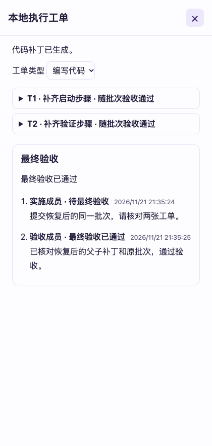

# souflow

souflow 是为一人公司打造的办公引擎。你交代一个目标，它组织数字员工把工作推进到可验收的结果。每次交付留下的需求、技术选择、文档和使用数据，都能成为这家公司自己的知识，帮助下一次决策。

**目前可以在本机体验对话、集中决策和 Codex 工单执行。** 未来的办公能力也要靠软件逐步实现，因此我们先用 TypeScript 快速迭代开发调度原型，用 souflow 自己的首版开发计划来检验它。

## 在本机体验

使用 Node.js 22.17.1 或更高版本，在仓库根目录启动演示工作台：

```sh
npm ci --ignore-scripts
npm run dev
```

打开 `http://127.0.0.1:4173`，输入「继续推进 souflow 首版开发」，体验从需求到规划文档的过程。点击「待决策」可以在同一处处理多个对话的问题。演示模式使用样例响应。

要让本机 Codex 实际工作，先停止演示服务，确认本机 Codex CLI 已登录，再运行 `npm run dev:codex`。此方式复用已有 Codex 登录。要让规划读取指定计划，可在本地 `.env` 用 `SOULFLOW_PROJECT_PLAN` 指向仓库中已提交的 Markdown 文件。模型、并发和成员身份的配置见[环境变量示例](.env.example)和[工作台运行说明](docs/architecture.md)。

## 目前已经实测的能力

| 能力 | 实际观察与证据 |
| --- | --- |
| 对话续推与规划 | 在固定的项目提交上读取计划和近期 PR，运行五阶段规划，处理澄清卡并归档产物。另一次只读工单试跑中，常规任务使用 Sol，跨模块任务使用 Astra，两者均产出报告。[项目续推与模型选择 · PR #11](https://github.com/DikkooXie/souflow/pull/11) |
| 本机并行与可视化 | 两张独立代码工单在本机 Codex 的独立会话和工作区生成补丁。调度面板另用两条并行核验会话实测，能查看正在运行的工单及等待前置报告的工单。[并行代码执行 · PR #8](https://github.com/DikkooXie/souflow/pull/8) · [调度面板 · PR #16](https://github.com/DikkooXie/souflow/pull/16) |
| 依赖与双成员验收 | 前置补丁等待验收时，下游代码工单保持等待。验收成员批准、实施成员继续派发后，下游使用指定版本的补丁。两位成员在同一台机器的独立浏览器环境中实测了权限、退回和最终验收。[依赖派发 · PR #14](https://github.com/DikkooXie/souflow/pull/14) · [成员验收 · PR #15](https://github.com/DikkooXie/souflow/pull/15) |
| 中断恢复 | 强制重启工作台后找回原批次和待验补丁；单独断开 App Server 后，旧澄清答复被拒，恢复时收到新问题。离线恢复数据库和产物目录后，两份补丁的摘要均与原记录一致。此轮规划响应和拆单固定，两张代码工单由本机真实 Sol 会话执行。[验收记录与三张截图](docs/acceptance/b4-recovery.md) |
| 操作审计 | 本机 SQLite 记录已提交的需求、决定和已登记的界面操作。演示场景中反复切换视图后，看板给出优化线索，重启后仍能查看历史。[审计看板 · PR #5](https://github.com/DikkooXie/souflow/pull/5) |



## 首版怎样才算达标

验收从一句 **「继续推进 souflow 首版开发」** 开始。操作者已经确认开发计划，接下来由调度器决定做哪张工单、开几个会话、何时接续。整条链路以真实仓库和真实账号验证。

| 场景 | 通过条件 |
| --- | --- |
| 认领真实工单 | 识别续推意图，根据计划拆单、标明依赖。通过通用连接层，用有权限的 GitHub 账号主动认领一张无人负责的 Issue，回读 assignee 后派发。重复事件只启动一次；与真人同时认领时能识别冲突。 |
| 同账号多会话，优先验收 | 同一个 Codex 账号下，独立工单可同时开工，有依赖的工单等待。会话数随可开工工单和可用资源变化。页面能从设备查到账号、会话、工单与进度。 |
| 跨账号分配 | 用两个独立 Codex 账号实际执行工单。结合订阅类型、可读取的剩余额度、限流反馈和当前负载选择执行账号，记录分配理由。无法读取的额度标为未知。GitHub 负责人和 Codex 执行身份分别留痕。 |
| 从开发到 PR | 按工单调研、比较方案、实现、测试并打开关联 Issue 的 PR，附验收证据。单张工单的执行授权止于开 PR。上游合并后，调度器从合并后的代码自动唤醒下游；上游关闭且未合并时，保留等待原因。 |
| 集中决策与审计 | 影响需求、架构或验收的取舍集中提交给人，其他独立工单继续。用户输入、澄清、点击、页面切换、认领、派发、失败、重试及交付都有可关联的记录，能从一次请求追到对应 PR。 |

当前的本机双成员验收和补丁依赖派发，是上述流程的一部分。真实 Issue 自动认领、跨账号负载分配、自动开 PR 与合并唤醒，仍待端到端实测。

## 每个模块如何选择方案

先在工单里写出要解决的问题、项目约束、可观察的验收条件和一个失败场景。随后查阅现有实现、官方文档及成熟项目，记录参考版本，并说明它解决的问题与本项目有多相近。需求尚在探索，现阶段选择 TypeScript 是为了缩短原型验证周期；架构和依赖也按实际约束逐项论证。

每个模块的设计记录都要回答：**比较过哪些可行方案？为什么选它？要接受什么代价？出现什么证据时应该改选？** 例如，本机队列容易拦住重复派发，但同事在 GitHub 上看不到谁已经开工。GitHub 指派让负责人对团队可见，又允许多人负责同一张 Issue。认领模块因此要分别验证本机重复事件和两位协作者同时认领这两种情况。

小模块可以把论证放在工单里。涉及权限、并发或持久化时，根据风险补上故障实验、迁移或回退办法。交付时附测试、必要的实际运行截图和未覆盖的条件。[开发质量规范](docs/engineering-quality.md) · [需求到工单的流程](docs/requirements-workflow.md) · [贡献指南](CONTRIBUTING.md)

## 企业知识怎样从真实开发中积累

我们要回答的具体问题包括「这个项目哪类任务值得开多个会话」「较强的模型在哪类工单上减少了返工」「改过的页面是否真的让人少切几次」。首版负责留下可核对的数据。让系统依据这些经验自动调整策略，是后续演进方向。

1. **开工前记录判断。** 把需求、技术栈、代码与计划版本、工单依赖、预计难点、候选方案及选择理由关联起来。保留当时的判断，复盘时才能发现哪里估错了。
2. **执行后记录代价与结果。** 关联测试和验收、人工介入的次数与原因、评审退回、合并后返工、耗时和可获得的模型用量。把页面切换关联到正在处理的任务，才能看出用户为什么来回找入口。
3. **把观察变成可检验的结论。** 比较单会话和多会话时，可用同一提交、同一任务和同一组验收条件分别试跑，再用相近的真实工单复核。记录样本、反例和适用范围。证据不足时标为待验证；工程质量达标且预算允许时，优先减少人工介入和返工，再考虑交付速度与模型用量。
4. **让下一张工单用得上。** 把结论编入项目知识库，链接到经授权的文档版本、工单、PR 和验收证据。新的结果可以修订旧结论，并保留修订理由。脱敏后的用户原话和操作明细保存在项目私有存储，可公开复核的工程知识随仓库维护。[知识库入口](docs/wiki/Home.md) · [来源与维护规则](docs/wiki-maintenance.md)

## 长期愿景

未来，souflow 希望覆盖传统公司的各项职能，包括行政、人力、财税、法务、情报收集和文档编写。用户可以在 souflow 里开会，由 AI 生成纪要，把决定整理成正式文档或待办并发给负责人；也可以让 AI 总结群聊，或在单聊中把一个原始想法谈成可落地的方案，再交给开发模块执行。从想法走到交付的过程中，人始终能看到依据、进展，以及哪些决定还需要自己做。

**先开发能帮助我们开发下一项功能的能力。** 例如，开发调度通过验收后，可以让 souflow 自己领取「把会议决定整理成待办」的工单，沿用已有的拆单、派发、评审和验收流程。会议模块交付后，下一次产品会就可以直接用它整理决定，把确认过的开发事项交回调度器，省去人工转述和重建工单。这是后续阶段的一种编排示例，具体顺序取决于真实需求和复用效果。[长期计划的编排方法](docs/requirements-workflow.md#编排长期开发计划)
