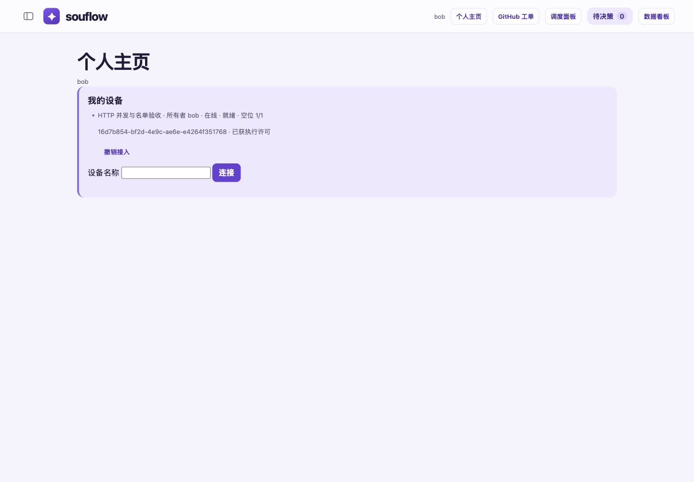
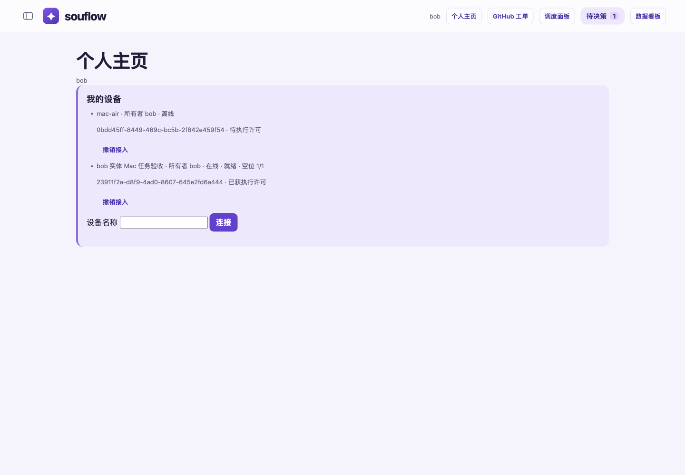
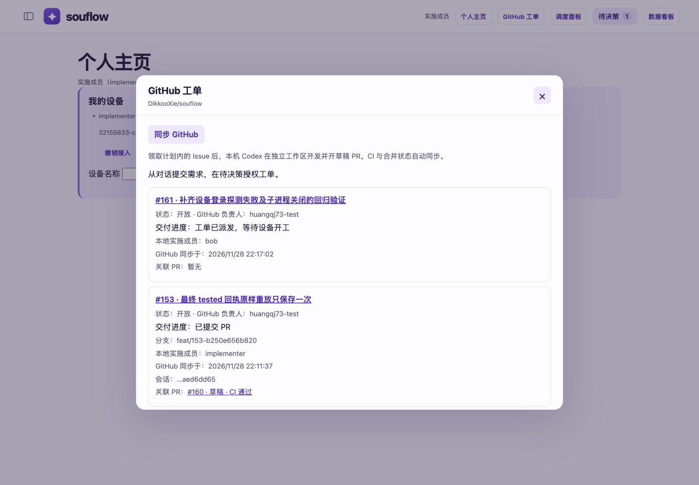
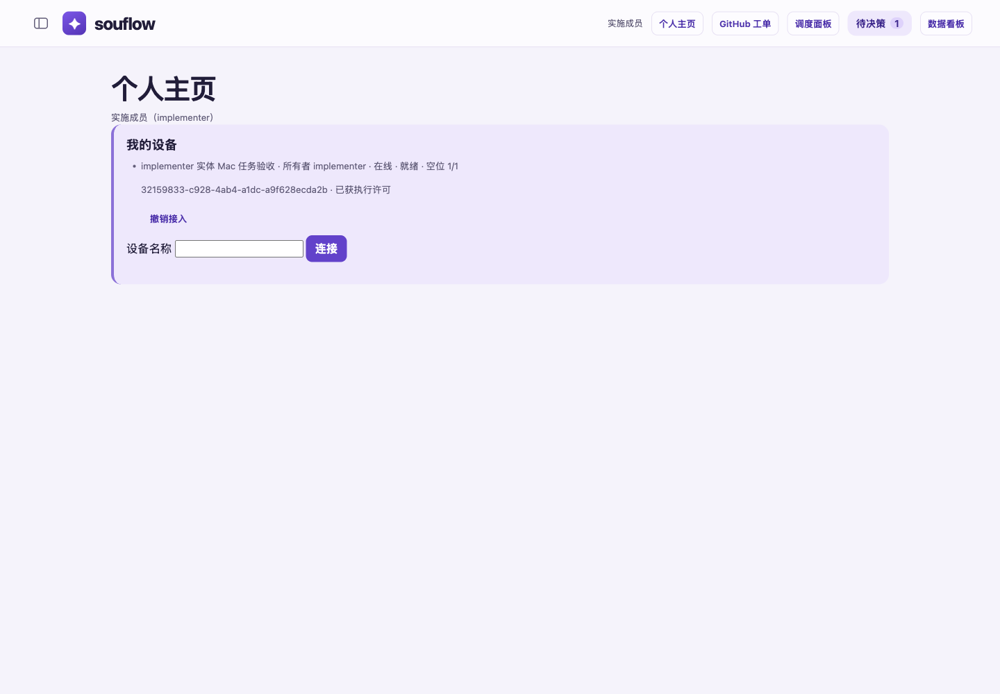
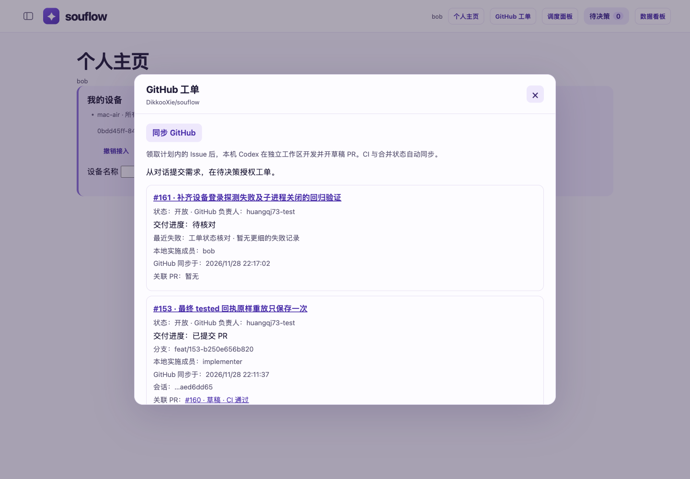

# AC-3 部分真机结果与平台合并记录

维护者用本页区分已经发生的实体设备操作、实际代码交付、未完成的受理竞态试验与仍未放行的业务 PR。记录对应 2026-11-28 的阶段档案，**不代表 AC-3 或首版整体验收通过**。

## 平台已合并，业务仍是草稿

| 对象 | 已核对的版本与状态 |
| --- | --- |
| 等待设备恢复平台 [PR #158](https://github.com/DikkooXie/souflow/pull/158) | 已合并 `c270bd369473a81322cdc566fe27e40fe1142e09`，保留原批准任务的设备等待状态与固定源码。 |
| 运行证据读取平台 [PR #162](https://github.com/DikkooXie/souflow/pull/162) | 已合并 `1eef2192f4fdad2480657b10fc44d7fc832f6735`，支持将维护者核实且绑定原计划、PR 提交及验收项的运行证据纳入双维复核。部分或失败结果不能被普通测试替代为完整通过；[契约与失效规则](../../trusted-verification.md)。这项平台能力不自动使业务验收通过。 |
| 业务 [Issue #107](https://github.com/DikkooXie/souflow/issues/107) / [PR #145](https://github.com/DikkooXie/souflow/pull/145) | 业务候选 `2f519e031eb1b57026594e3a0a37c7482256d460`，PR 为开放草稿，[该提交 CI 通过](https://github.com/DikkooXie/souflow/actions/runs/46152056533)。 |
| 独立验收 [Issue #153](https://github.com/DikkooXie/souflow/issues/153) / [PR #160](https://github.com/DikkooXie/souflow/pull/160) | 本人正常批准后由 souflow 创建工单并自动交付，头提交 `fed73338171f06690cd3f98f3fc6938b35cd9506`，PR 为开放草稿，[该提交 CI 通过](https://github.com/DikkooXie/souflow/actions/runs/46153274524)。 |
| 独立验收 [Issue #161](https://github.com/DikkooXie/souflow/issues/161) | 收到真实 offer、生成 accepted 后由本人撤销，原尝试被中断；没有关联 PR。放行后的服务端拒绝尚未实证。 |

## 三种版本分别计数

纯业务头的 HTTP 与设备接入试验运行 `2f519e0`，使用独立数据库，没有业务工单执行授权。实际派发试验另运行 `8637bb3991bc36184529bec602980ec86ebe4ed9`，它由平台 `c270bd3` 与业务头正常合并而成；主机与第二台实体 Mac 的运行源码各有受控清单和哈希。该集成版本检查为 389 项通过、3 项跳过、0 项失败。

#153 与 #161 实际签出的原批准任务源码均为 `deb294eb9d07ff491deb0ee4cfc427cb804f0dc5`。集成运行器的提交不能替代任务源码，也不能替代 #145 的业务头。第二台实体 Mac 通过 Tailscale HTTPS、独立目录和本机 Codex 执行，主机仅复用既有 SSH 操作，没有复制 Codex 凭据。

[原始证据摘要](evidence.json)按源文件名保留 HTTP 结果、真实设备事件与审计；[来源清单](source-manifest.json)保留受控原件的 SHA-256，原件不全作为单独文件公开。[原阶段档案](AC3-PARTIAL-20261128.md)按原字节留存。公开摘要仅移除绑定清单中的本机接入文件路径，未改写状态、标识或响应。成员密钥、配对码、接入文件、TLS 文件、数据库和完整未筛选日志不入公共仓库。截图均为实际 Chrome 的原图，已逐张检查。

## 纯业务头的双成员 HTTP 与实体接入

正常认证 HTTP 入口验证了本人列表隔离、对方确认同码 409 后本人仍可确认 201、个人页与调度入口跨成员撤销均 404、本人撤销 200。两台真实连接器此前均在线就绪，撤销后退出 1，旧接入文件自检均返回 HTTPS 401。浏览器原生确认对话框曾被另一 CDP 客户端关闭，未把那次失败点击算成成功撤销；成功结果来自正常认证 HTTP 请求。

同一配对码的真实并发确认得到 201 与 409，随后重放 409；原码从 UTC 14:15:11.504 自然等待到 14:20:12.504 后确认返回 409。同次新设备 `16d7b854-bf2d-4e9c-ae6e-e4264f351768` 在许可外连接器退出 1、自检 403 且退出 1；正常加载许可并重启独立服务后，同一 ID 在线、就绪、空位 1/1，没有重新配对或替换凭据。对应摘要键为 `http-expiry-concurrency.json`、`http-same-id-permitted.json` 及 `http-2f519e03-*`。

## 集成运行中的真实工单与重连去重

| 验收观察 | 实际结果与摘要键 |
| --- | --- |
| 对方设备在线不等于有权执行 | 只有 Bob 实体设备在线时，implementer 的 #153 连续观察 50 秒；设备多次报告 ready、slots=1，但 offers=0、taskStarts=0。`153-wrong-owner-waiting.json`、`153-wrong-owner-peer.json`。 |
| 本人批准后真正执行并开 PR | 原零 offer 记录经平台显式 `recoverDeviceWait` 正常恢复，没有改库或重建 Issue。第二台 Mac 收到执行 `e2e1fd31-04ea-487d-a30e-cc1a2d0157bd`，accepted 200，实际 Codex 任务启动一次，测试通过后由 souflow 自动开 #160。`153-recovered.json`、`153-peer-receipts.json`、`153-live-running.json`。 |
| 真正断线后重发同一冻结回执 | 观察器只丢弃第一次已到主机的 tested 200 响应，再阻断该验收连接器的 HTTPS 45 秒。设备恢复后自行重发同一摘要 `15fc40c2…b46636b`，再次获 200；tested 审计仅一次（112），真实任务启动仅一次，重连审计 117。未伪造 offer、回执或模型结果。`153-peer-receipts.json`、`153-terminal-dedup.json`。 |

## #161 只证明撤销成功与零开工

Bob 正常批准后由 souflow 创建 #161，真实执行 `79888211-bbe5-4c72-a0a1-adc7c2a5c265` 收到 offer 并生成 accepted。本人通过正常接口撤销返回 200，平台中断该尝试，真实任务启动为零。

观察器先建立 HTTPS 请求再暂扣 `end`，遇到产品正常的 5 秒 headers / 10 秒 request 超时；连接器在放行前退出 1，**没有取得放行后的拒绝响应**。因此不能把零启动写成「撤销后释放同一 accepted 已被服务端拒绝」。`161-peer-receipts.json`、`161-owner-revoked-before-accepted.json`、`161-attempt-audit.json`保留该失败边界。

#161 已有真实 offer，不能通过零 offer 恢复重派，也不手改数据库或伪造批准。该项需修正受控传输夹具，再以新的正常批准工单补证。两个成员各自的真实独立工单都完成、跨机 PR 合并交接和首版全链路仍未证实；#153 的交付与 #161 的中断分别计数。

## 部分证据进入复核，仍未放行

原地址工作台已升级至 `1eef219`，两台设备在线就绪。原 v14 的 #107 在同一业务头上重新取得第 4 份原生复核回执，已读取部分真机证据包，仍未通过。[原包](bundle.json)的 AC-3 outcome 为 partial，包摘要为 `69ca036f08665df70b231e2857fbec7848c9b88214826bb51575414a7d126914`，有效期至 UTC 2026-12-05 14:25:46.919；[回执摘要](receipt-summary.json)绑定同一 `2f519e0` 与 `8637bb3`，状态 block。包内的有效期不延长业务版本的适用范围，变更后依然要复验。

实现复核提出了「GitHub 已改派、工作台未刷新时的受理窗口」，当前按**复核提出，待核实/修复**处理，不把它写成已经证实的根因或已通过的验收。

本页补充[此前原 #107 自动交付记录](../issue107-auto-delivery/README.md)。B5、B6 保持「需求测试中 / 待验收」；平台合并、技术实测、AI 复核和最终业务验收分别记录。

## 归档验证

文档基线 `1eef219` 使用 Node 22.17.1 运行 `npm run check`：类型与静态检查通过，390 项测试中 387 项通过、3 项跳过、0 项失败。受控阶段清单的全部原件均与所列 SHA-256 一致；五张归档原图、原阶段档案及部分包引用文件按原字节保存。公开摘要的路径移除有单独记录，本地链接、内部地址和凭据模式检查通过。技术检查通过不改变上面的部分验收状态。
