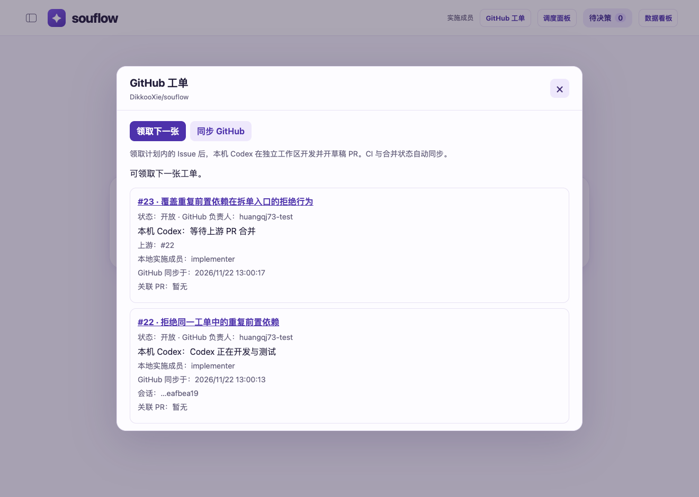

# B5 从真实 Issue 到关联 PR 的验收

2026-11-22 在 macOS 本机工作台使用 GPT-6.2 Sol，连接 `huangqj73-test`。工作台同时管理 [#22 校验重复前置](https://github.com/DikkooXie/souflow/issues/22)与 [#23 补拆单入口测试](https://github.com/DikkooXie/souflow/issues/23)。用已经安装的 `node:22.17.1` Docker 镜像执行检查。浏览器访问真实工作台与 GitHub，工单和 PR 来自同一真实仓库。

| 验收项 | 结果 |
| --- | --- |
| 领取无人负责的 Issue | 两张工单均由工作台认领，GitHub 负责人为已绑定账号。 |
| 独立工作区开发、测试、开 PR | #22 由本机 Codex 生成校验逻辑和回归测试。容器检查通过后，工作台创建独立分支 `feat/22-8a29b1879331` 和带关闭引用的 [PR #24](https://github.com/DikkooXie/souflow/pull/24)，CI 通过。 |
| 人工评审前阻塞下游 | #23 在上游尚未合并时保留「等待上游 PR 合并」，且重启后仍等待。 |
| 自动唤醒与去重 | 集成测试覆盖上游无关 PR 合并、创建回执丢失、重启、重复同步与所关联 PR 合并。真实合并触发待 PR #24 完成。 |
| 本机回归 | `SOULFLOW_TEST_NATIVE_CODEX=1 npm run check` 通过，共 67 项，零跳过。 |

