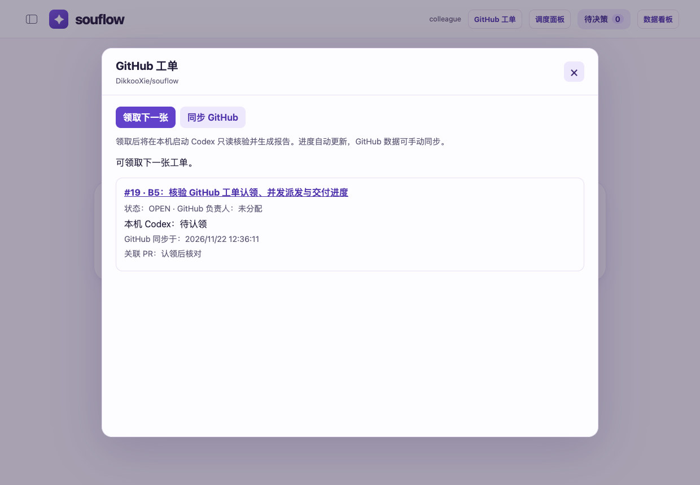
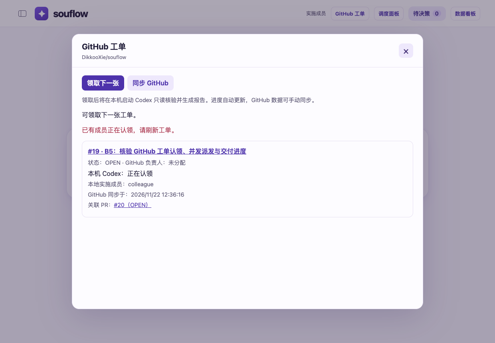
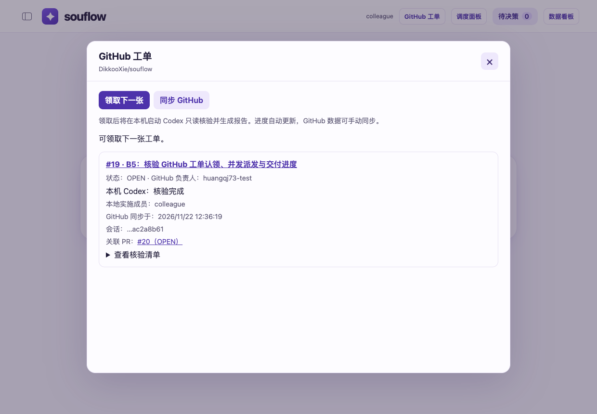

# B5 GitHub 工单认领验收

2026-11-22 在 macOS、Node.js 22.17.1、本机 Codex App Server 和版本 `d46ad68` 的工作台上，用两个有写权限的 GitHub 账号同时领取真实仓库的 [Issue #19](https://github.com/DikkooXie/souflow/issues/19)。两个实施成员分别登录独立的 Chromium 环境，共用同一持久化工作台。

| 操作 | 实测结果 |
| --- | --- |
| 同步待领取工单 | #19 开放、无人负责。 |
| 同时点击「领取下一张」 | 绑定 `huangqj73-test` 的成员收到 HTTP 200，绑定 `2692341798` 的成员收到 HTTP 409。两个账号分别回读 GitHub，均看到唯一负责人 `huangqj73-test`。 |
| 执行只读核验 | 本机 GPT-6.2 Sol 返回核验清单，工作台显示「核验完成」、会话尾号 `ac2a8b61`、负责人和来自 GitHub 的关联 [PR #20](https://github.com/DikkooXie/souflow/pull/20)。 |
| 重试并重启工作台 | 获胜成员用原请求重试，重启后再次重试，均返回 200。另一成员以新请求领取时返回 409。原会话与报告恢复一致。审计记录共有两次重放、一次派发、一次连接和一次完成。 |
| 全量回归 | `SOULFLOW_TEST_NATIVE_CODEX=1 npm run check` 通过，64 项测试通过，0 项跳过。 |

本轮覆盖同一工作台内的并发控制。外部人员可以直接在 GitHub 修改负责人，工作台回读发现冲突就停止派发。此次执行产物是核验清单。自动修改 Issue 对应的代码、开关联 PR 和上游合并后唤醒下游，另行验收。
