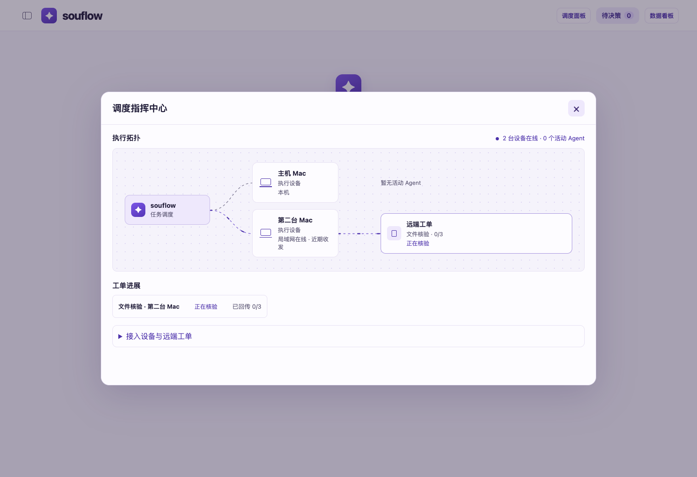
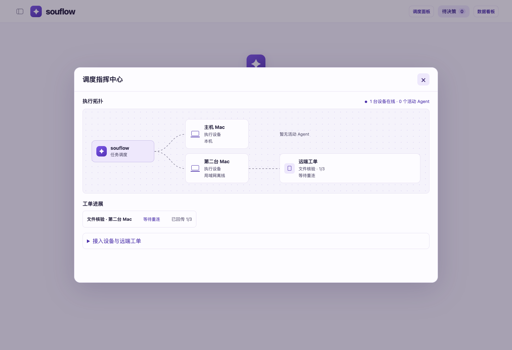
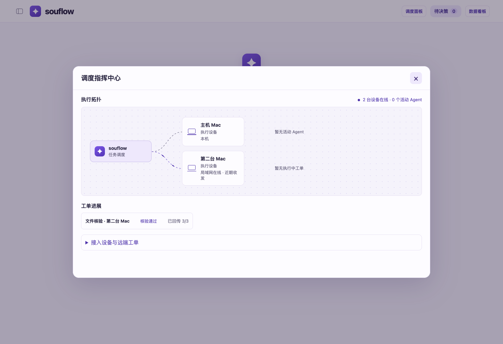

# B6 Tailscale 双机设备直连实测

2026-11-24，以主干 `576dfc5` 为基线测试本次 Tailscale 接入变更。主机运行 Codex 工作台，第二台实体 Mac 运行本次源码的设备程序，经 Tailscale 连接主机的 souflow HTTPS 设备接口。SSH 用于启动和中断第二台 Mac 上的设备进程，核验工单和回执走设备接口。

| 场景 | 实测结果 |
| --- | --- |
| 启动和接入 | 主机使用本机 Tailscale IPv4 和对应证书启动。浏览器工作台只监听回环地址。非本机共享地址、错误证书 IP SAN 和通配监听地址均被拒绝。 |
| 领单与通信 | 第二台 Mac 领取一张包含三份文档的只读核验工单。对比真实通信期间连续的两帧画布，确认连线流动。空闲、离线和减少动态效果时连线静止。 |
| 中断与恢复 | 首份回执到达后终止设备客户端，工作台显示离线并保留 `1/3`。重新启动客户端后，同一设备实例和工单补齐至 `3/3`。 |
| 通信审计 | 记录一次领取、一次重连及三份回执。领取、回传和心跳包含通信方向，审计未包含设备凭据或文件正文。 |

`npm run check` 通过，128 项测试通过、3 项原生 Codex 用例按配置跳过。双机试验使用设备只读核验能力。代码交接的独立证据见[首版双机单账号试用](two-mac-code-handoff.md)。
