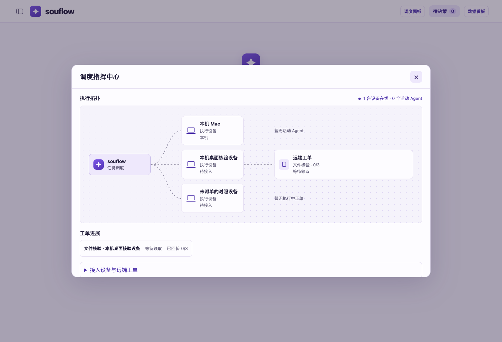
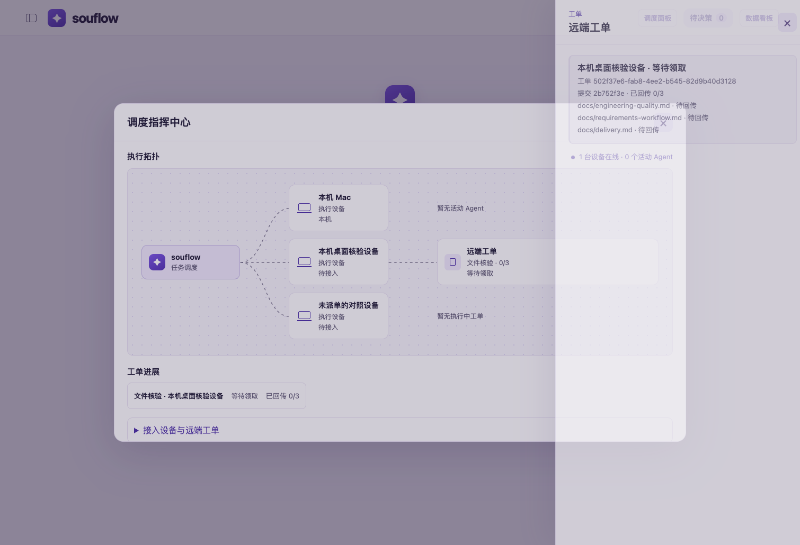
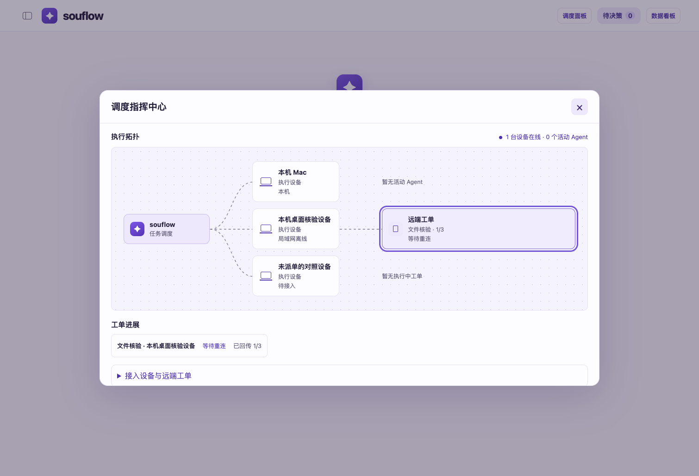
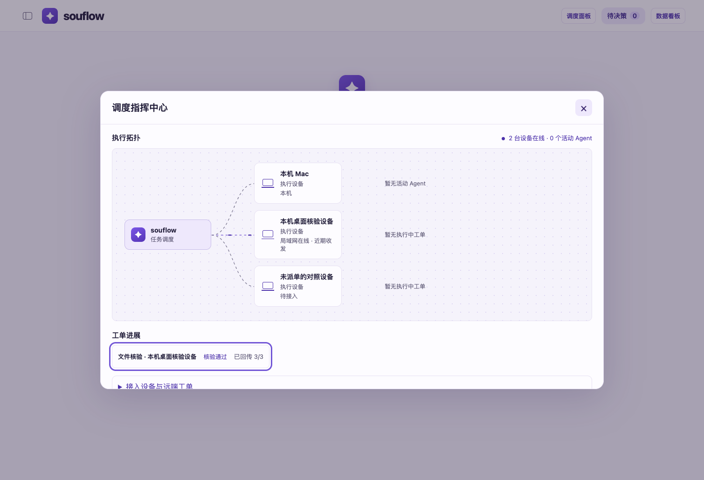

# B6 调度拓扑排队工单验收

2026-11-24，从 souflow 工作台输入「继续推进 souflow 首版开发」。规划会话读取主干 830936a，自主选中未分配的 [Issue #55](https://github.com/DikkooXie/souflow/issues/55)。派发前检查范围、依据和验收方法均通过。用户在「待决策」确认后，souflow 通过已连接 GitHub 账号认领，由本机 Codex 在隔离工作区开发并执行 npm run check，自动开出 [PR #56](https://github.com/DikkooXie/souflow/pull/56)。审计按顺序各保留一次预约、派发、检查通过和 PR 发布。

固定 PR 提交 2b752f3，在本机独立工作台用 Chrome、实际 HTTPS 设备轮询和 SQLite 审计验证。目标设备 A 领取三份文档的核验工单，对照设备 B 不派单。旧版会在工单列表显示排队，但拓扑的设备下没有节点。

| 场景 | 观察结果 |
| --- | --- |
| A 待接入或已离线，尚未领取 | 只有 A 下出现等待领取的工单，进度 0/3，派单连线静止。打开节点详情可核对工单 ID 和文档。 |
| A 领取并回传第一份核验 | 同一节点进入执行状态，显示 1/3。 |
| A 中断通信 | 同一节点显示等待重连，保留 1/3，连线停止流动。 |
| A 重连并补齐回执 | 原工单完成到 3/3，从活动拓扑移除，仍可在近期工单中查看。 |

[PR 提交 CI](https://github.com/DikkooXie/souflow/actions/runs/45389506600)和 Codex 评审通过，业务改动合入主干 403027f，Issue #55 已关闭。本次设备客户端运行在同一台 Mac，使用隔离的 HTTPS 端口。此前的[实体双机接入与续传](lan-device-handoff.md)和[双机单账号代码交接](two-mac-code-handoff.md)各有独立证据。当前版的实体双机复验，以及首版路线中 P1-a 和 P1–P5／V01–V24 的逐项验收记录，仍需补齐。
