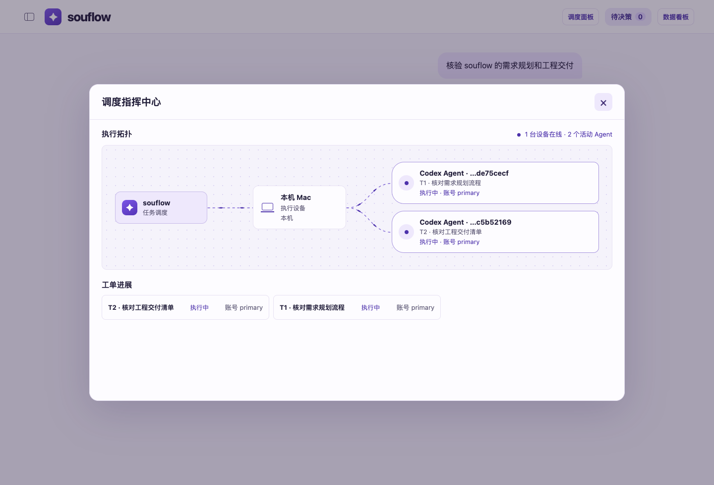
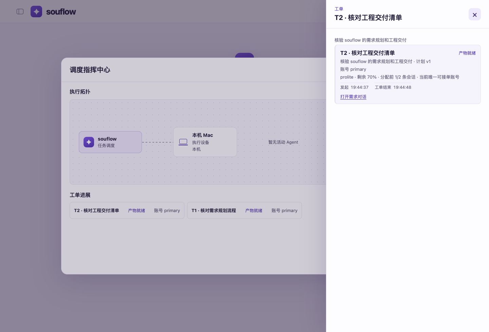

# Codex 账号调度验收

2026-11-22 在 macOS、Node.js 22.17.1 和本机 Codex App Server 上验证。本轮使用一个真实 ChatGPT 登录，规划和拆单采用固定输入。两张核验工单均由实际登录的 GPT-6.2 Sol 会话执行。

| 验收项 | 结果 |
| --- | --- |
| 单账号同时接两张工单 | `primary` 的工单并发上限为 2。两个独立会话有一致的本机账号标记，工单执行区间重叠 10.739 秒，均产出核验报告。 |
| 工作台显示分配依据 | App Server 回读的套餐为 `prolite`，当时的窗口余量为 70%。T1、T2 分配前分别有 0/2、1/2 个执行占位。工单详情显示别名、套餐、窗口余量和「当前唯一可接单账号」。 |
| 历史与审计可回读 | 用同一验收数据库的副本重新启动工作台，两个工单的账号与分配理由仍可查看。审计包含两条分配事件。 |
| 双账号的分配和失败分支 | 自动化测试用两个独立的测试身份验证负载、额度和套餐的排序，覆盖满载、重复登录、额度未知、明确限流、取消、失败释放和恢复。GitHub 工单测试覆盖分配记录回读。 |
| 两个真实登录接单 | 本机目前只有一个登录。两个真实账号各自完成工单以及该场景下的实际额度变化仍待验收。 |

启用原生检查运行 `SOULFLOW_TEST_NATIVE_CODEX=1 npm run check`。账号选择和凭据边界见 [本机 Codex 账号调度](../architecture.md#本机-codex-账号调度)。
