# 对话选单与 GitHub 交付验收

2026-11-22，在 macOS 和本机已登录的 Codex 上读取 souflow 首版计划 `docs/requirements-workflow.md`，规划基线为 `06e1c4a`。启用对话选单，未配置 Issue 编号、文件或依赖的静态计划。规划使用 GPT-6.2 Astra，计划授权后的代码执行使用 GPT-6.2 Sol。

| 验收 | 结果 |
| --- | --- |
| 发起 | 从工作台只输入「继续推进 souflow 首版开发」。五阶段规划完成，自动进入真实 GitHub 候选选单。 |
| 选单与依赖 | 选择 [#27 冻结调度快照](https://github.com/DikkooXie/souflow/issues/27)与 [#28 补回归测试](https://github.com/DikkooXie/souflow/issues/28)，提案记录了范围及 #28 依赖 #27。 |
| 授权前边界 | 待决策展示选单理由、修改文件、计划版本和测试要求。服务重启后原卡片仍可核对，GitHub 回读两张 Issue 均无人认领。 |
| 授权后认领与排队 | 发起者在待决策确认后，审计先记录授权，再认领 #27 和 #28。#27 启动本机 GPT-6.2 Sol，#28 保持「等待上游 PR 合并」。 |
| 独立开发、测试和 PR | #27 在从 `06e1c4a` 建立的隔离工作区生成提交 `6381a85`，只改动获准的调度快照实现。容器质量检查通过后，工作台创建带 `Closes #27` 的 [草稿 PR #30](https://github.com/DikkooXie/souflow/pull/30)，[GitHub CI](https://github.com/DikkooXie/souflow/actions/runs/44991910046) 通过。 |

运行 `SOULFLOW_TEST_NATIVE_CODEX=1 npm run check`。72 项通过，零跳过。授权边界测试覆盖改版、非发起者、双击重试、授权后认领不确定、Issue 文本变化和依赖派发。

## 合并后复验

本轮采用一个本机 Codex 登录。[PR #30](https://github.com/DikkooXie/souflow/pull/30) 合入 `7b9aadb` 后，工作台自动唤醒 #28。首次执行在产生补丁前失败。人工重新排队后，第二次执行产出了测试补丁，但隔离测试未通过。两次尝试均未开出 PR。

人工在已授权的测试文件内修正会话连接回调的断言，并补开 [PR #34](https://github.com/DikkooXie/souflow/pull/34)。回归测试验证旧快照保留读取时的连接状态，以及修改读取到的快照不会影响正在运行的会话。PR #34 合入 [`1702dce`](https://github.com/DikkooXie/souflow/commit/1702dce4cf45aa3ce144f180cede98efceb7e5f0)，[主干 CI](https://github.com/DikkooXie/souflow/actions/runs/45007007394) 通过，[Issue #28](https://github.com/DikkooXie/souflow/issues/28) 随合并关闭。

本轮验证了对话选单、授权后的上游自动开 PR 和合并后自动唤醒。下游未自动完成的情况保留作历史记录。基于本机交付计划完成下游自动开 PR 的另一轮实测见 [B5 交付验证](b5-delivery.md)。

## 单句续推与自动接力复验

2026-11-22，在 macOS 以主干 `5492dc8` 启动 souflow，启用对话选单，读取仓库首版计划。使用本机已登录的 Codex，Astra 规划，Sol 执行。检查容器使用 `node:22.17.1`。

| 验收项 | 结果 |
| --- | --- |
| 单句发起与授权 | 浏览器中只输入「继续推进 souflow 首版开发」。自主选出 [#36 列表依赖识别](https://github.com/DikkooXie/souflow/issues/36)与 [#37 补依赖回归测试](https://github.com/DikkooXie/souflow/issues/37)。两张 Issue 在确认待决策前均无人负责。授权卡列明文件范围和 #37 对 #36 的依赖。 |
| 上游自动交付 | 本机 Codex 仅修改获准的 `src/planning/github-selection.mts`。容器质量检查通过，工作台自动开 [PR #38](https://github.com/DikkooXie/souflow/pull/38)，[GitHub CI](https://github.com/DikkooXie/souflow/actions/runs/45009292026) 通过。#37 保持等待。 |
| 合并唤醒 | 上游经评审合入 `492208f`。工作台读到合并回执后，只唤醒 #37 一次。下游工作区父提交为 `492208f`，使用新的本机 Codex 会话。 |
| 下游自动交付 | 本机 Codex 只在 `tests/conversation-delivery.test.mts` 新增回归测试。容器质量检查通过后，工作台自动开 [PR #39](https://github.com/DikkooXie/souflow/pull/39)，[GitHub CI](https://github.com/DikkooXie/souflow/actions/runs/45009519724) 通过。 |
| 审计与独立复验 | 同一流程只有一次需求提交和一次交付授权。审计顺序为上游合并回读、下游唤醒、连接、质量检查通过、发布。两张工单分别只创建一个工作区和一个 PR，未触发人工重排队、改代码或补开 PR。把自动生成的回归测试放到旧基线复跑时失败，在合并后的代码上通过。 |
| 合并与工单关闭 | PR #38 和 #39 均通过各自最新提交的 CI 和 Codex 评审。上游合入 [`492208f`](https://github.com/DikkooXie/souflow/commit/492208f498b54675d82035a4ee5030665d6cea7c)，下游合入 [`0c40828`](https://github.com/DikkooXie/souflow/commit/0c40828518077eb89dcfb264d70013d1a19f9c94)，Issue #36 和 #37 均已关闭。 |

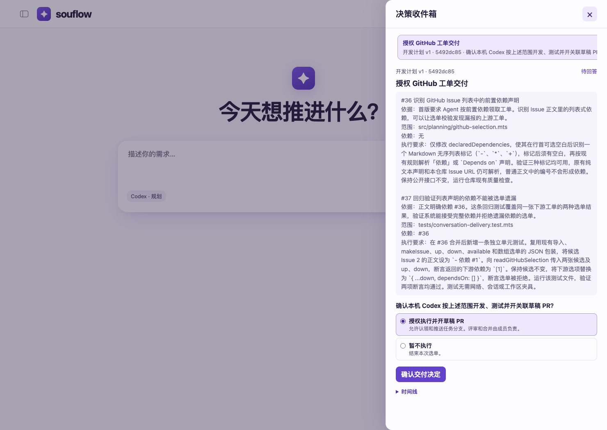

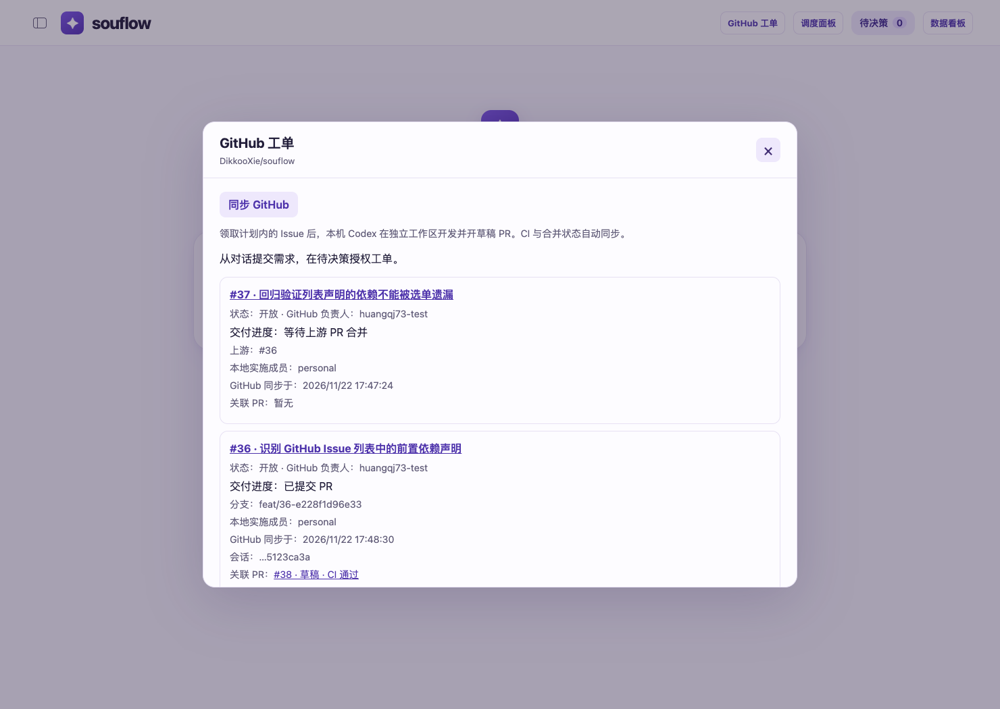

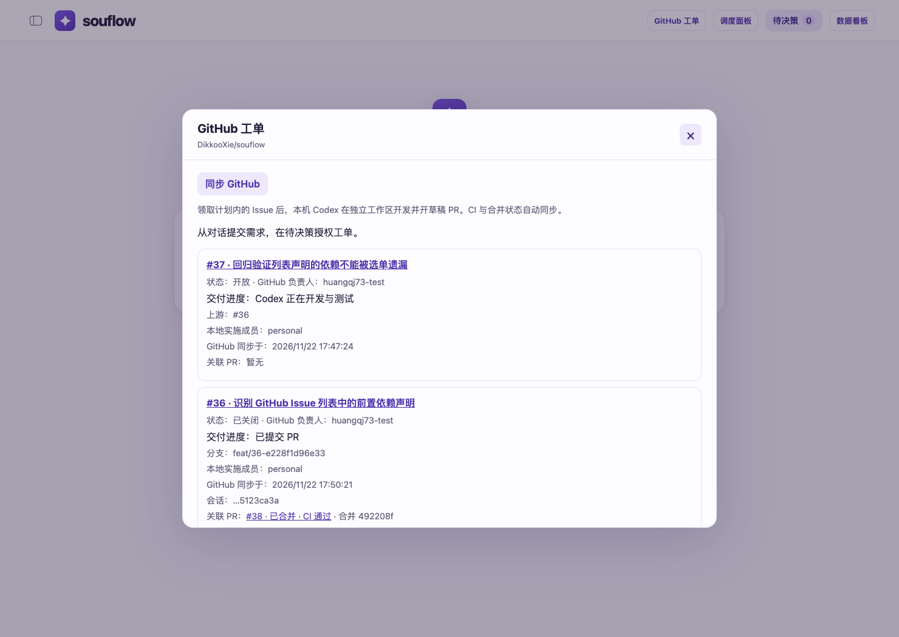

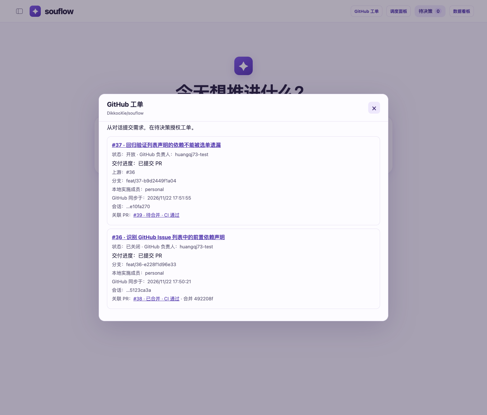

本轮覆盖单机、同一个 Codex 登录和一对真实依赖工单。B5 团队验收、跨 Codex 账号调度和双机试点分别记录。

## v14 双机自动建单和下游复验

2026-11-26，原工作台用同一对话的 v14 计划自动创建 #105、#106 和 #107。两台实体 Mac 的本机 Codex 并行开发前两单，自动开 [PR #112](https://github.com/DikkooXie/souflow/pull/112) 和 [PR #114](https://github.com/DikkooXie/souflow/pull/114)。两份 PR 均通过 CI 并合并。随后，[PR #125](https://github.com/DikkooXie/souflow/pull/125) 和 [PR #126](https://github.com/DikkooXie/souflow/pull/126) 分别处理成员轮询与连接器自检回归，并通过实现质量与需求兑现复核。两台 Mac 的原生 HTTPS 自检与 Codex 登录均通过，自检前后的持久设备实例相同。

[Issue #107](https://github.com/DikkooXie/souflow/issues/107) 复用原对话、工单、计划版本与授权，在 `a14f9a2` 重新复核固定源码后由主 Mac 接单。审计 1086 为源码复核通过，1087–1090 依次记录唤醒、派发、设备接收及 Codex 开工。每个动作只有一条，复核完成后刷新状态也没有重复派发。

设备完成候选补丁的准备和应用。安装依赖的容器退出码为 0，隔离质量检查容器退出码为 2。审计 1096 为设备检查失败，1097 为工作台确认失败。GitHub 回读 #107 仍开放，关联 PR 和任务分支均为空。失败记录目前只留阶段，明细与候选留存由 [#129](https://github.com/DikkooXie/souflow/issues/129) 跟进。首版 [#67](https://github.com/DikkooXie/souflow/issues/67) 仍待下游交付与两类复核通过。

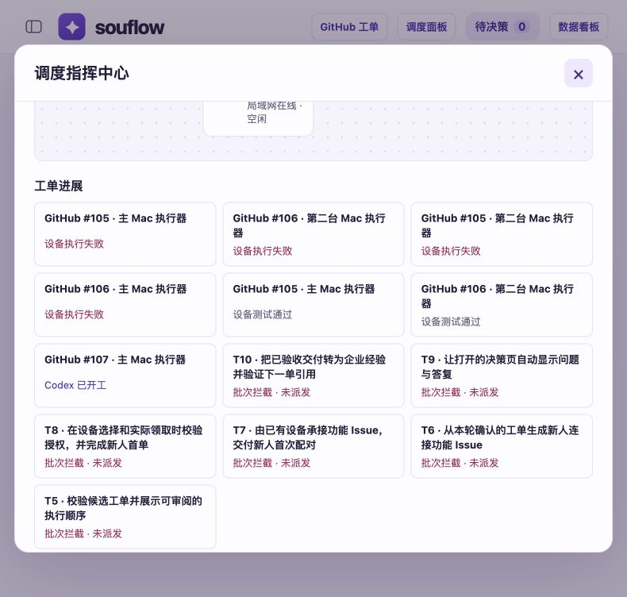

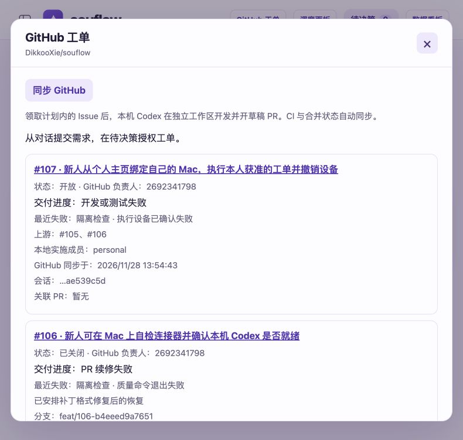

### 当前主干重新复核后追加测试范围

2026-11-28，原址工作台升级到 [#133](https://github.com/DikkooXie/souflow/pull/133) 的合并提交 `d342210`，原对话和 SQLite 数据库继续使用。两台 Mac 均重新接入。对照升级前的派发记录，#107 有一次历史设备开工和测试失败。

| 本轮观察 | 实测结果 |
| --- | --- |
| 源码复核 | 审计 1121、1122 记录原 v14 工单排队恢复并开始复核。1125、1126 记录复核拦截并进入待核对。 |
| 设备和 GitHub | 本轮新增开工 0 次，无新增测试回执或关联 PR。 |
| 补充范围 | 两项测试获准追加。一是他人确认配对码会被拒，原发起人仍可使用。二是执行名单有效且设备已经收到工单时，再次受理必须核对当前授权。 |
| 修订入口 | 已提交批次调用原对话重规划返回 HTTP 409。首次发布前给单张工单追加测试范围由 [#134](https://github.com/DikkooXie/souflow/issues/134) 跟踪。 |

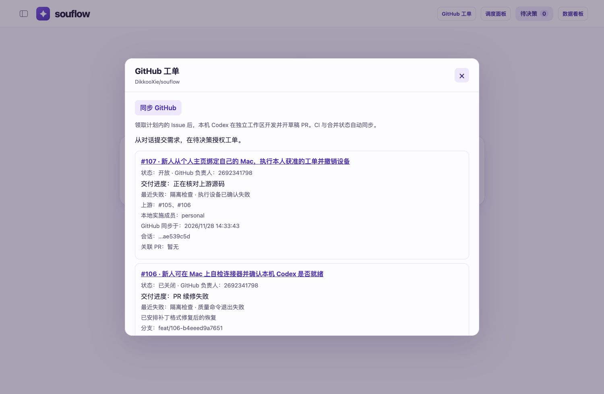

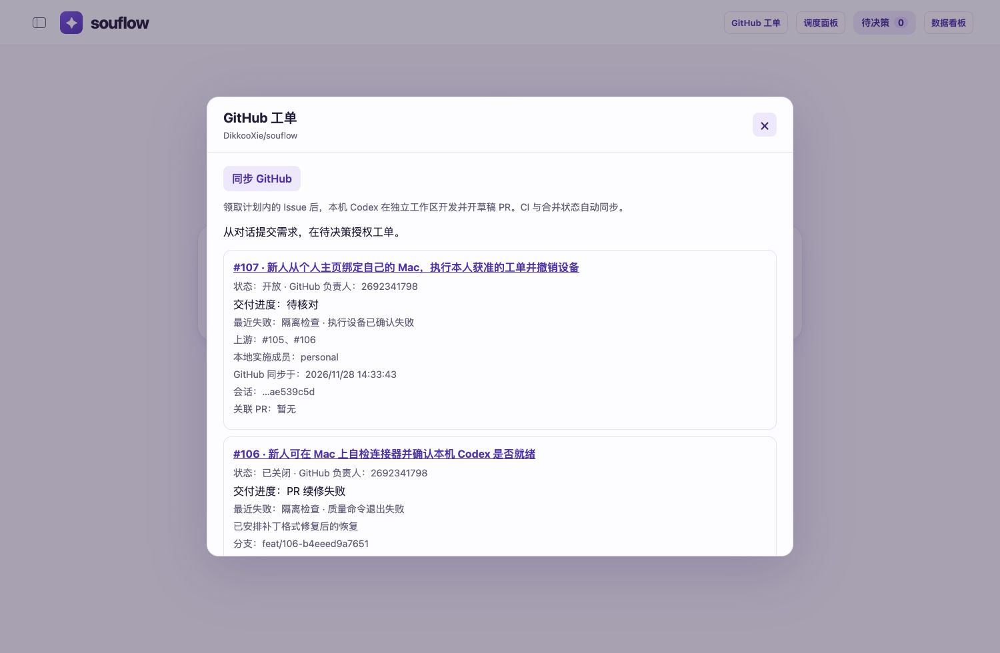

### 在原对话为 #107 补充两项回归并续跑

2026-11-28，原址工作台运行 [PR #136](https://github.com/DikkooXie/souflow/pull/136) 的合并提交 `c458c1d`。成员在 v14 的待决策卡授权补充两个测试文件。`tests/remote-handoff.test.mts` 验证乙无法消费甲的有效配对码、甲仍能使用原码确认。`tests/code-worker-pool.test.mts` 验证设备已收单且仍在执行名单内时，授权缺失或所有者不符均会阻止受理和启动 Codex。

审计 1132、1137、1138 记录修订发起、答复和生效。独立只读复核引用了 8 处固定版本源码，1143、1144 记录复核通过。新执行编号 `d80182cc` 对应一次派发（1145）、一次受理（1147）和一次开工（1148）。同一个设备执行范围包括原先的 4 个实现文件和新获准的 2 个测试文件。

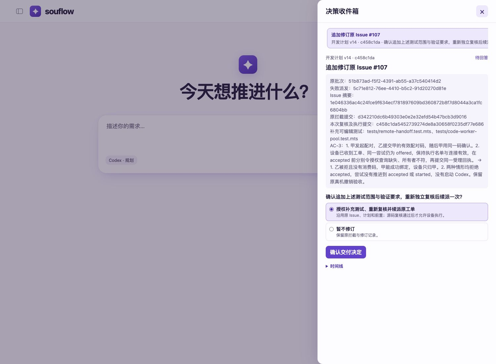

第二台 Mac 的设备程序为 `03477a1`，本次执行的仓库基线为 `c458c1d`。设备在开工 4 分 6 秒后回报 `failed`，阶段为 `patch`（审计 1152、1153）。设备日志确认接单及回报，回执仅保存失败阶段，没有失败的替换序号或可回放的候选补丁。测试通过回执、任务分支和关联 PR 均为空。原 [#107](https://github.com/DikkooXie/souflow/issues/107) 保持开放。设备补丁诊断由 [#137](https://github.com/DikkooXie/souflow/issues/137) 跟踪。

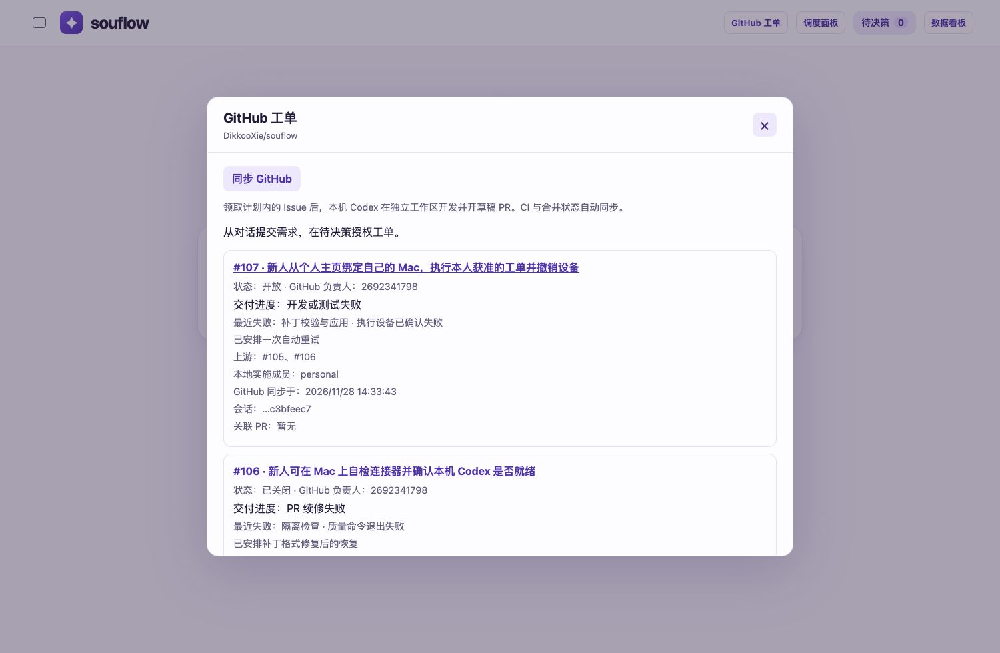

### 主 Mac 设备补丁诊断复验（#137）

2026-11-28，主 Mac 用本机登录的 Codex 和 HTTPS 连接器复验 [#137](https://github.com/DikkooXie/souflow/issues/137)。试验工作台和连接器的实现版本为 `a159dd5`，工单目标固定在 `34ec9a7`，使用独立的 SQLite 数据库。两个用例都要求在同一文件前追加一行注释，编辑内容由 Codex 生成。

- 拒绝用例将试验连接器的单文件容量设置为原文件的 1,043 字节。设备依次回报受理、开工和失败。首份补丁与自动修正均回报 `file-size`、第 1 项替换，同一个派发只有一条开工审计。重新打开工作台后，从调度面板点开工单可以回读两条诊断。
- 正常用例给这次追加留出容量。连接器安装固定依赖，应用补丁，在断网、只读挂载的 Node 22.17.1 容器中执行完整检查。此前嵌套检查曾因 Node 包装脚本自循环而停住，[运行器修复](https://github.com/DikkooXie/souflow/pull/140)随本次验证覆盖了旧目标提交。

截图取自试验结束后重新打开的工作台。原对话的 #107 在本轮新增派发 0 次。第二台 Mac 的升级与实测已在[独立验收记录](peer-patch-diagnostics/README.md)补齐，保留各自试验与版本边界。

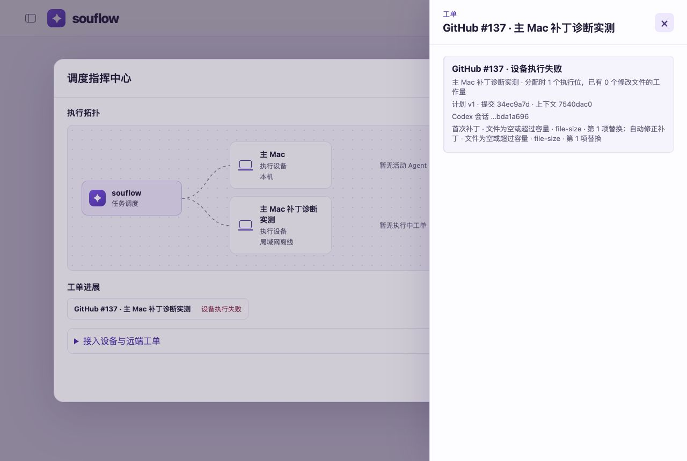

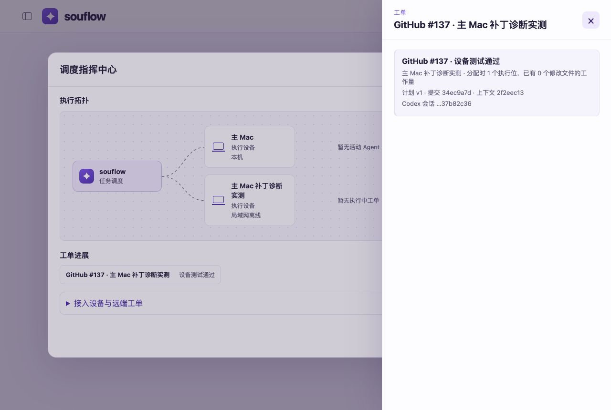

两次独立派发的编号前缀为 `4a66fe5d`（失败）和 `4451d493`（测试通过）。本机验证采用试验派发，无 GitHub 发布动作。
