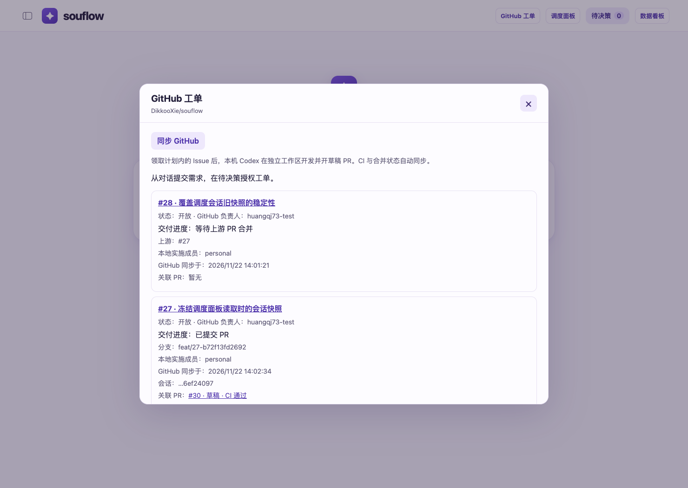

# 对话选单与 GitHub 交付验收

2026-11-22，在 macOS 和本机已登录的 Codex 上读取 souflow 首版计划 `docs/requirements-workflow.md`，规划基线为 `06e1c4a`。启用对话选单，未配置 Issue 编号、文件或依赖的静态计划。规划使用 GPT-6.2 Astra，计划授权后的代码执行使用 GPT-6.2 Sol。

| 验收 | 结果 |
| --- | --- |
| 发起 | 从工作台只输入「继续推进 souflow 首版开发」。五阶段规划完成，自动进入真实 GitHub 候选选单。 |
| 选单与依赖 | 选择 [#27 冻结调度快照](https://github.com/DikkooXie/souflow/issues/27)与 [#28 补回归测试](https://github.com/DikkooXie/souflow/issues/28)，提案记录了范围及 #28 依赖 #27。 |
| 授权前边界 | 待决策展示选单理由、修改文件、计划版本和测试要求。服务重启后原卡片仍可核对，GitHub 回读两张 Issue 均无人认领。 |
| 授权后认领与排队 | 发起者在待决策确认后，审计先记录授权，再认领 #27 和 #28。#27 启动本机 GPT-6.2 Sol，#28 保持「等待上游 PR 合并」。 |
| 独立开发、测试和 PR | #27 在从 `06e1c4a` 建立的隔离工作区生成提交 `6381a85`，只改动获准的调度快照实现。容器质量检查通过后，工作台创建带 `Closes #27` 的 [草稿 PR #30](https://github.com/DikkooXie/souflow/pull/30)，[GitHub CI](https://github.com/DikkooXie/souflow/actions/runs/44991910046) 通过。 |

运行 `SOULFLOW_TEST_NATIVE_CODEX=1 npm run check`。72 项通过，零跳过。授权边界测试覆盖改版、非发起者、双击重试、授权后认领不确定、Issue 文本变化和依赖派发。

## 合并后复验

本轮采用一个本机 Codex 登录。[PR #30](https://github.com/DikkooXie/souflow/pull/30) 合入 `7b9aadb` 后，工作台自动唤醒 #28。首次执行在产生补丁前失败。人工重新排队后，第二次执行产出了测试补丁，但隔离测试未通过。两次尝试均未开出 PR。

人工在已授权的测试文件内修正会话连接回调的断言，并补开 [PR #34](https://github.com/DikkooXie/souflow/pull/34)。回归测试验证旧快照保留读取时的连接状态，以及修改读取到的快照不会影响正在运行的会话。PR #34 合入 [`1702dce`](https://github.com/DikkooXie/souflow/commit/1702dce4cf45aa3ce144f180cede98efceb7e5f0)，[主干 CI](https://github.com/DikkooXie/souflow/actions/runs/45007007394) 通过，[Issue #28](https://github.com/DikkooXie/souflow/issues/28) 随合并关闭。

本轮验证了对话选单、授权后的上游自动开 PR 和合并后自动唤醒。下游全自动开发和开 PR 在本轮仍待复验。基于本机交付计划完成下游自动开 PR 的另一轮实测见 [B5 交付验证](b5-delivery.md)。
