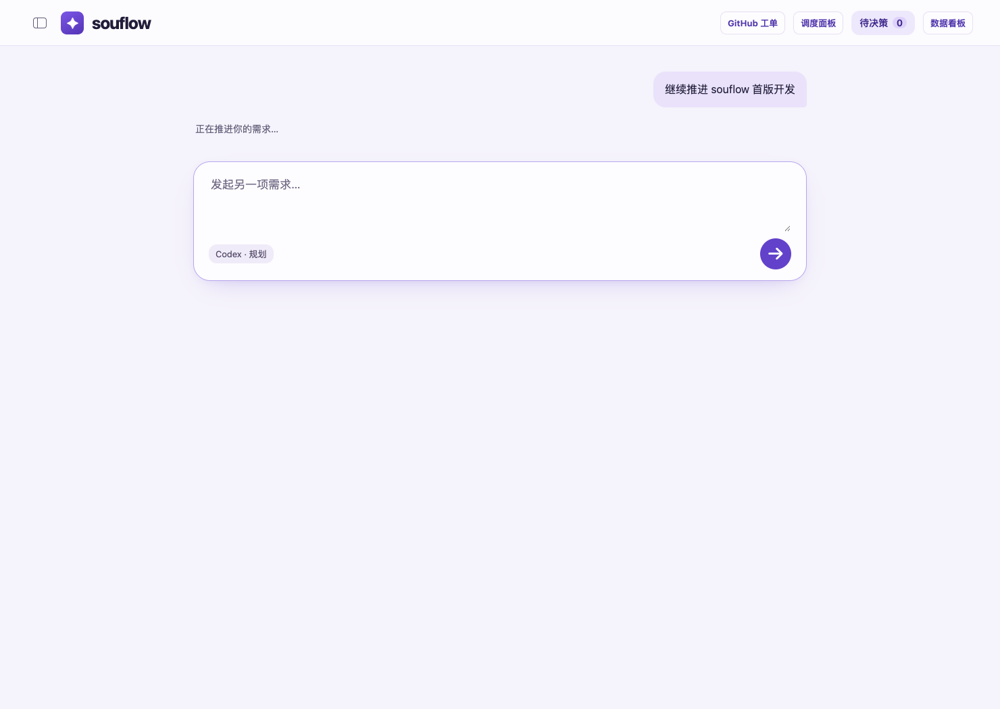
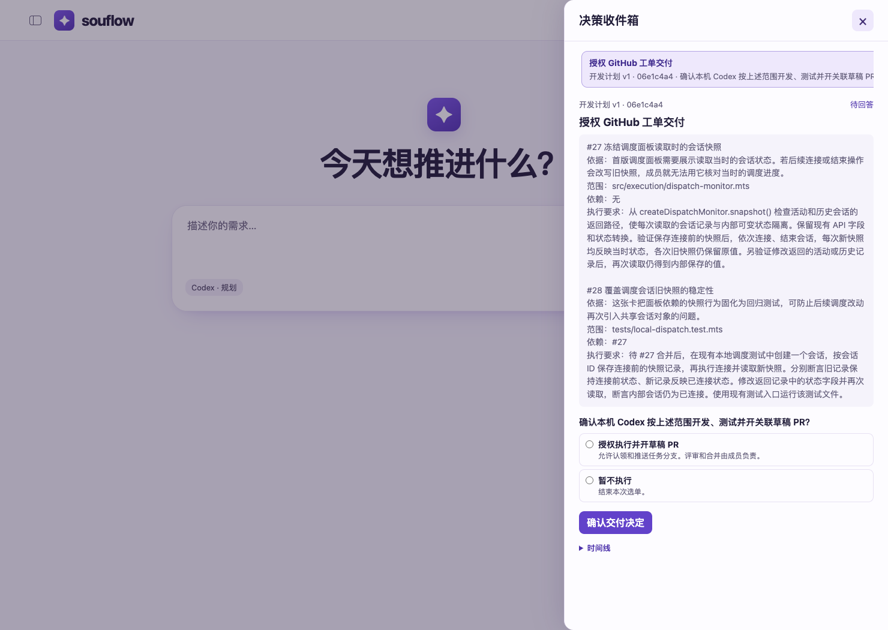

# 对话选单与 GitHub 交付验收

2026-11-22，在 macOS 和本机已登录的 Codex 上读取 souflow 首版计划 `docs/requirements-workflow.md`，规划基线为 `06e1c4a`。启用对话选单，未配置 Issue 编号、文件或依赖的静态计划。规划使用 GPT-6.2 Astra，计划授权后的代码执行使用 GPT-6.2 Sol。

| 验收 | 结果 |
| --- | --- |
| 发起 | 从工作台只输入「继续推进 souflow 首版开发」。五阶段规划完成，自动进入真实 GitHub 候选选单。 |
| 选单与依赖 | 选择 [#27 冻结调度快照](https://github.com/DikkooXie/souflow/issues/27)与 [#28 补回归测试](https://github.com/DikkooXie/souflow/issues/28)，提案记录了范围及 #28 依赖 #27。 |
| 授权前边界 | 待决策展示选单理由、修改文件、计划版本和测试要求。服务重启后原卡片仍可核对，GitHub 回读两张 Issue 均无人认领。 |
| 授权后认领、开发与关联 PR | 集成测试通过。真实工作台等待操作者确认。 |

运行 `SOULFLOW_TEST_NATIVE_CODEX=1 npm run check`。72 项通过，零跳过。授权边界测试覆盖改版、非发起者、双击重试、授权后认领不确定、Issue 文本变化和依赖派发。
