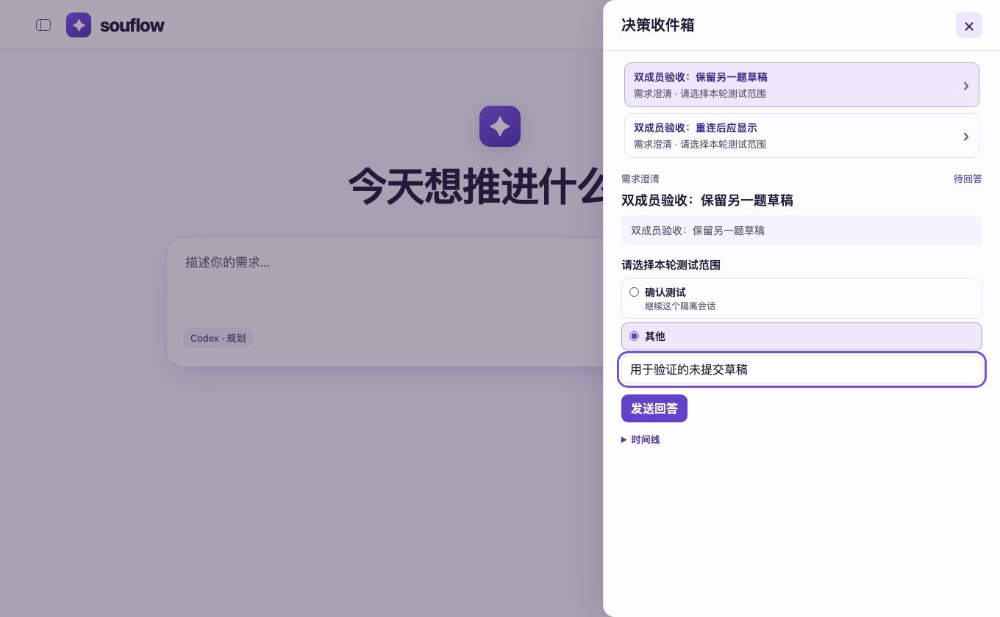
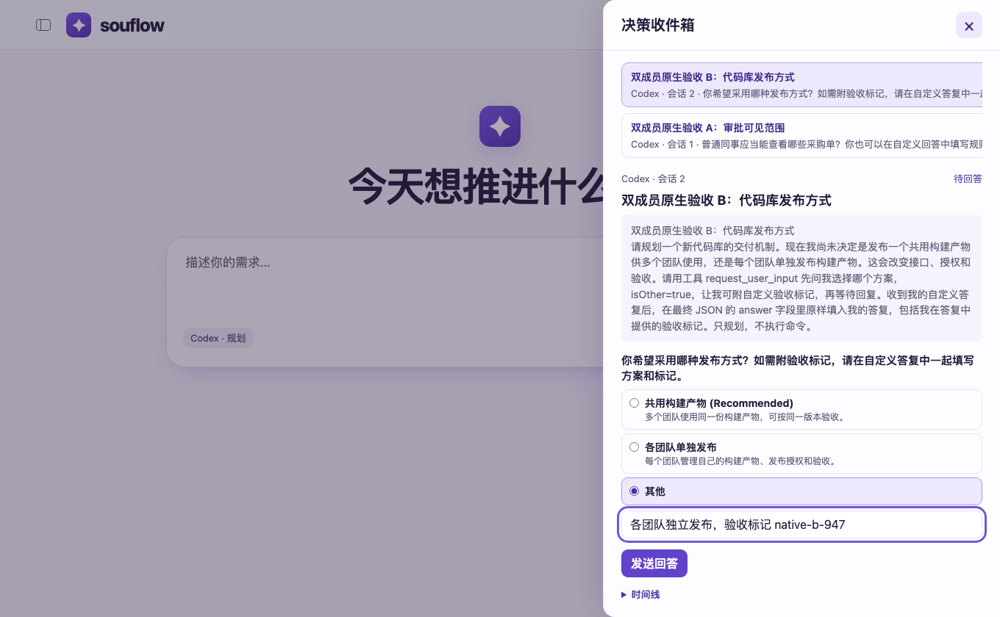

# 待决策自动刷新验收

在主干 `06413da` 上验证本次刷新补丁。个人工作台空闲时复用成员工作台已有的轮询节奏。待决策的可见范围、回答权限和服务端接口沿用现有规则。

## 个人模式

在隔离浏览器双页中，主干的服务端新增第三条待决策后，空闲页 5 秒内仍显示 2 条。应用补丁后，新提问在 1.87 秒显示，答复在 0.11 秒同步，查询恢复后 0.36 秒回读。另一张卡的草稿和输入焦点保留，迟到的旧查询未覆盖已提交答复。

## 双成员浏览器

在同一台 Mac 上使用独立浏览器登录，分别以两位实施成员身份访问同一个隔离工作台。受控提问用于复现新增、答复、断网和查询乱序。

| 验收项 | 观察结果 |
| --- | --- |
| 一方发出新提问，另一方保持页面打开 | 1.87 秒显示 |
| 一方答复，另一方看到待答卡移除 | 0.11 秒同步 |
| 第二个浏览器断网后恢复 | 0.36 秒回读，离线期间已答的卡没有重新出现 |
| 草稿和迟到查询 | 草稿与焦点保留，旧快照未恢复已答卡 |
| 角色与重复提交 | 未登录查询返回 401，验收角色回答普通澄清返回 403，重复答复返回 409 |

## 本机 Codex 原生会话

第一位成员启动两个 GPT‑6.2 Astra 规划会话。真实 Codex App Server 各发一张结构化卡片，第二位成员在浏览器依次回答后发与先发的卡片。两个原会话各自回显自己的验收标记，并分别给出关闭回执。每张卡审计只记录一次答复。发起成员的页面分别在 0.10 秒、0.36 秒移除已答卡。

