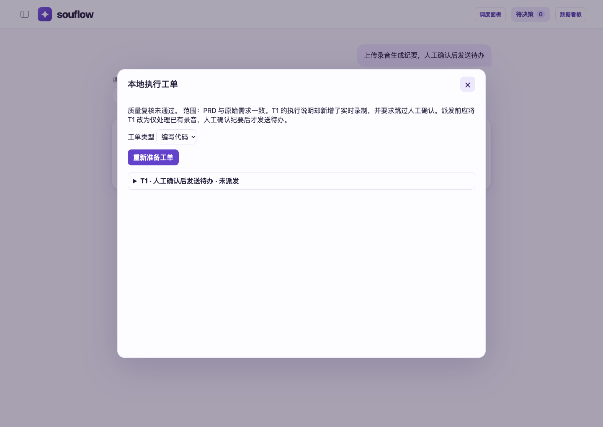
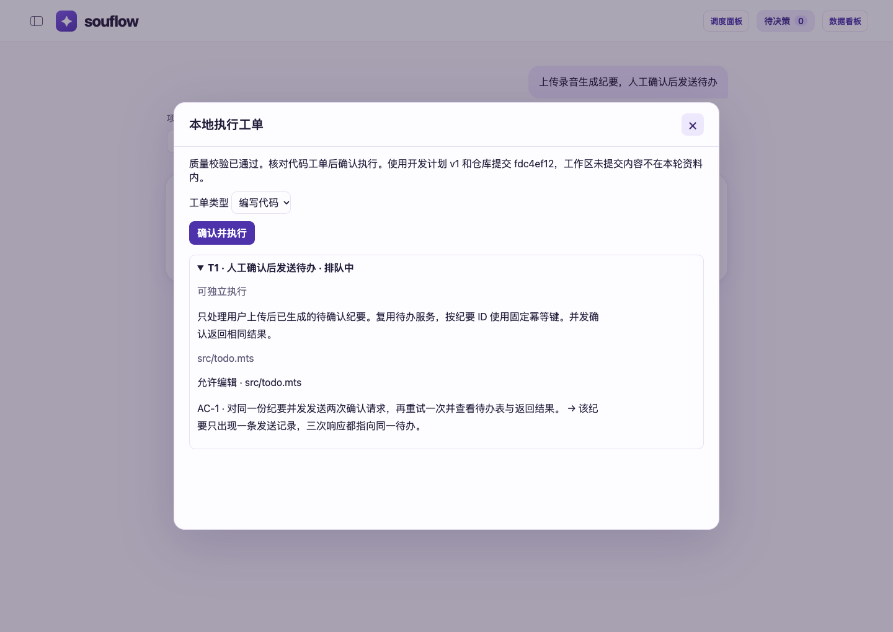

# 派发前质量校验实测

2026-11-22，在本机登录的 Codex App Server 中，用独立的 GPT-6.2 Astra 只读会话复核固定样例。合格样例的需求是「上传录音生成纪要，人工确认后发送待办」。PRD 限定已有录音，计划复用待办服务，验收用同一份纪要的并发确认与重试验证只发送一次。

| 样例 | 实际复核结果 |
| --- | --- |
| 合格 | 范围、依据与验证均通过。验证引用了并发确认和重试的步骤及只生成一条待办的预期。 |
| 越出范围 | 拦截。候选工单加入实时录制并跳过人工确认。 |
| 缺少依据 | 拦截。开发计划依赖未提供代码或接口证据的第三方投递保证。 |
| 验收编号与验证不符 | 拦截。工单引用了重复确认的验收项，步骤却只发一次请求。 |

工作台用上述两份真实复核结果回放固定规划和工单。阻塞后执行按钮隐藏。准备修正后的候选工单并通过校验后，现有按钮可供确认。截图中的样例没有执行代码或向 GitHub 写入。

自动化回归覆盖两个入口的阻塞、无关引文、同版正文改变、重试、引用与依赖、冻结 Git 基线、以及修订后重新校验。GitHub 阻塞用例确认不会生成授权卡、认领或开 PR。过去的静态 GitHub 代码计划需要迁移至对话交付配置。
