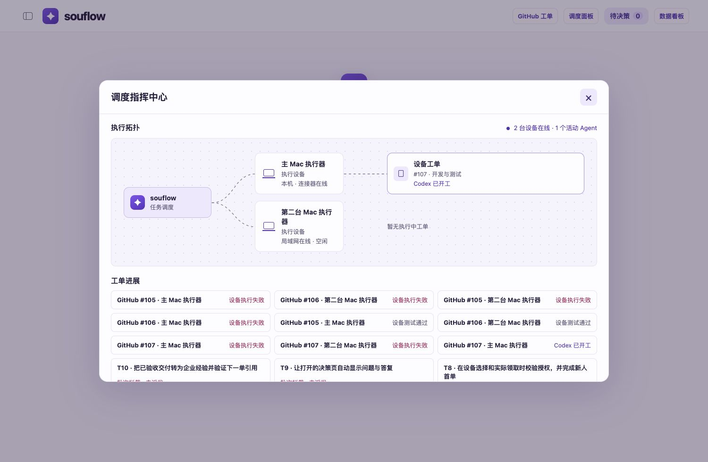
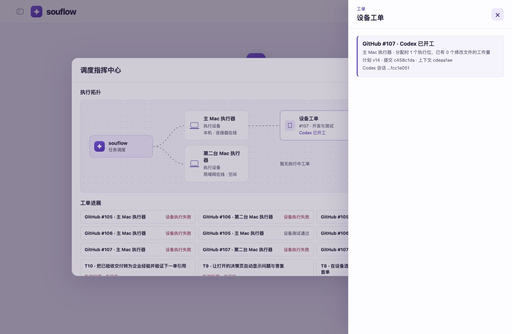
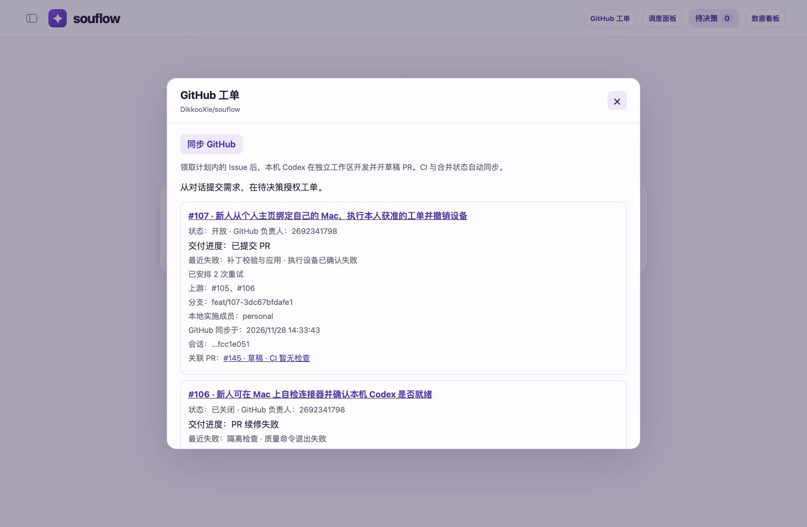
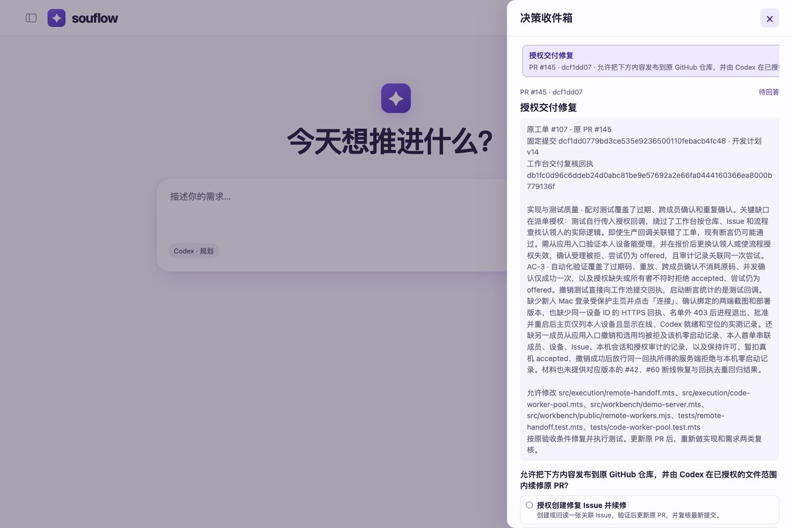
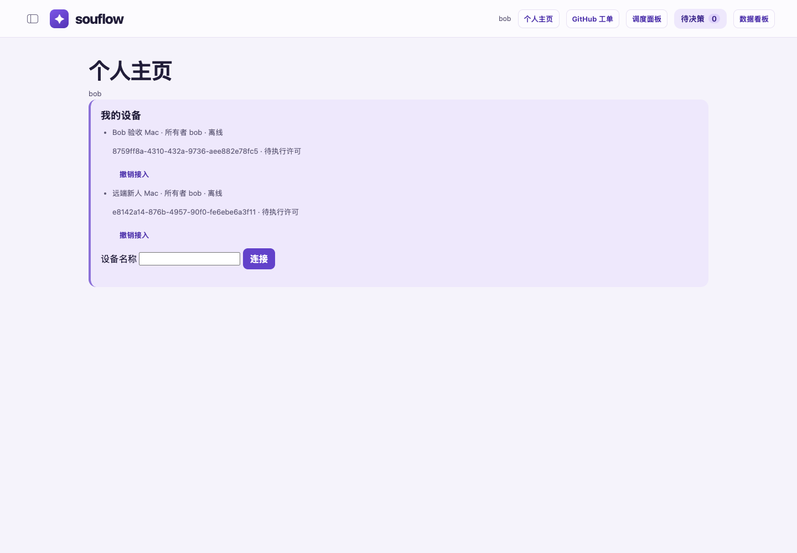
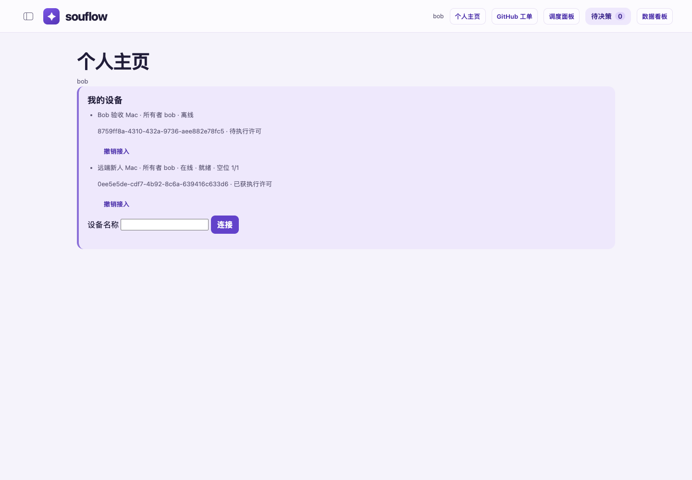
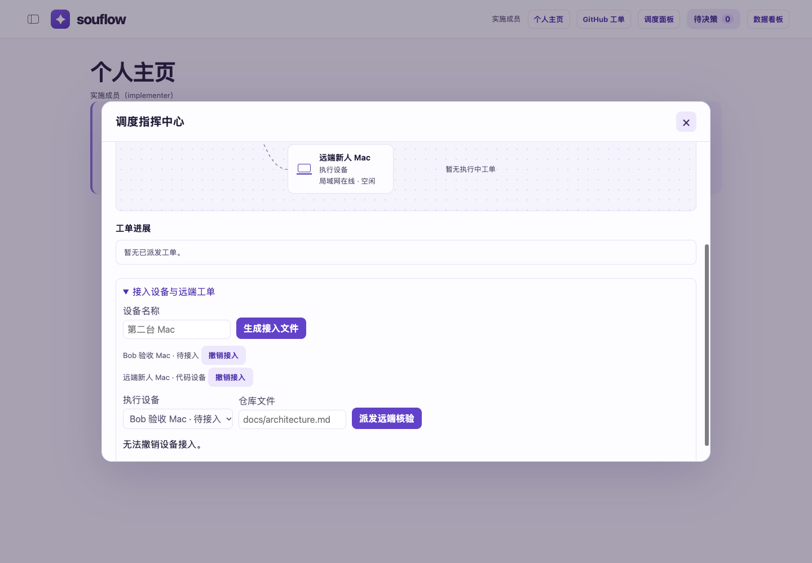
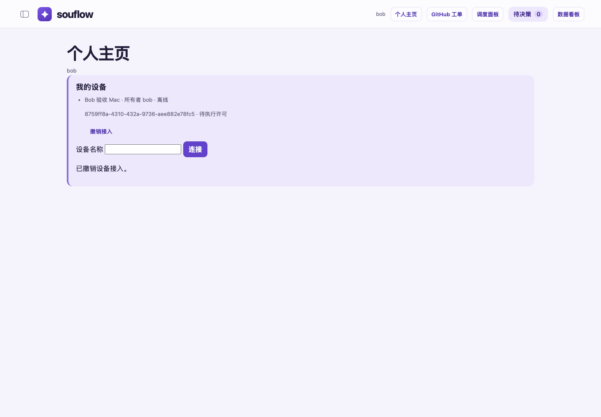
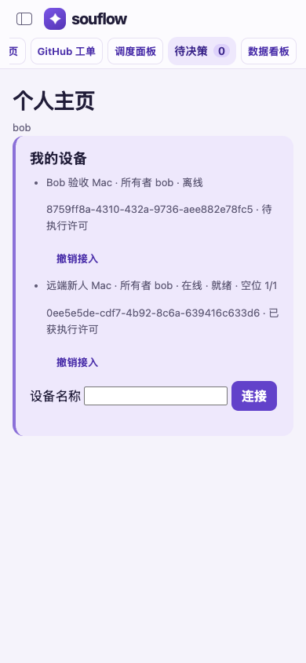

# #107 自动交付与待修结果

维护者用本页核对原对话 v14 的 #107 如何实际开发、测试并自动创建 PR，以及为什么该交付仍待修复与验收。

本页执行结果的阶段快照截至 **2026-11-28 21:07（Asia/Singapore，UTC+08:00）**，另记录随后明确的新版接入路径。后续续修及复验以新记录追加，不将本快照写成最终验收。

2026-11-28，原址工作台在 [`6911147f85ef0d7eff0c6697e6a856af544085de`](https://github.com/DikkooXie/souflow/commit/6911147f85ef0d7eff0c6697e6a856af544085de) 恢复原工单，主 Mac 使用本机 Codex 在独立工作区执行。原计划仍为 v14，固定目标源码为 `c458c1da5452739274de8a30658f0235df77e686`，补充范围沿用已批准的修订 `31e2fc20`。本轮执行 `b2dab1f6` 产出提交 [`dcf1dd0779bd3ce535e9236500110febacb4fc48`](https://github.com/DikkooXie/souflow/commit/dcf1dd0779bd3ce535e9236500110febacb4fc48)，由 souflow 自动创建关联 #107 的[草稿 PR #145](https://github.com/DikkooXie/souflow/pull/145)。

## 一次开工完成设备与主机检查

精简[审计与版本回执](107-evidence.json)将原对话、修订、执行、设备及 PR 绑定在一起；只保留可公开的状态、标识和分类，不公开原始提示、源码或凭据。

| 可观察结果 | 对应证据 |
| --- | --- |
| 重新核对固定源码后派发 | 审计 1171–1174 记录恢复排队、读取并复核源码；1175 offered、1177 accepted、1178 started，各一次。 |
| 自动修正后设备检查通过 | 1186 tested 保留首次 `edit-count`、18 项替换的诊断；自动修正发生在同一次设备执行内，没有第二次 started。 |
| 主机复验与自动开 PR | 1189 local-check-complete、1190 checked、1191 published，绑定同一提交与 PR #145。 |
| GitHub 检查通过 | 固定提交 `dcf1dd0` 的 [Quality CI](https://github.com/DikkooXie/souflow/actions/runs/46146848798) 为 SUCCESS。CI 通过与工单验收分别判断。 |

关联 PR 截图采集时工作台尚未回读 CI；上表使用 GitHub 同一提交的最终 CI 结果。卡片中的「最近失败」保留更早的补丁失败历史，不是本轮执行状态。

## 双维度复核仍有阻塞

针对固定提交 `dcf1dd0` 的[独立 AI 复核记录](https://github.com/DikkooXie/souflow/pull/145#issuecomment-7239578891)和原工作台交付复核均未放行；精简回执记录 implementation=block、requirements=block（审计 1196）。这是 AI 内容复核，不是人工 GitHub 批准。

- 实现质量：原复核指出旧设备没有明确 owner 时无法被新查询选中；从真实工作台入口核对当前授权的验证仍需补齐。[#146](https://github.com/DikkooXie/souflow/issues/146) 跟踪旧记录兼容与引导，不能仅按在线状态或名称推断归属。后续明确的首版接入路径是用新版重新登录、配对并获取新 ID，旧记录保留为历史；不把原设备 ID 自动继承列为强制新增验收项。
- 需求兑现：现有测试覆盖跨成员确认不消费原码、失权后拒绝受理，但 AC-3 的双成员受保护页面、设备接入、撤销后同一受理回执及实际开工次数仍需对应版本的运行证据。

平台 [PR #147](https://github.com/DikkooXie/souflow/pull/147) 已合并到 `08408cbe459a0ae69db40358ed7456d099a3bd7b` 并部署原址；新的授权修复卡保留原 #107、原 PR #145 与原计划 v14，将原 4 个实现文件及已批准的 2 个测试文件一起带入修复范围。下图采集时卡片尚待回答，只证明修复授权内容可回查，不表示已经修复、重新开工或复核通过。

截图之后，原工作台审计 1206 记录真实批准 `review-repair-approved`，1210–1212 自动创建并关联[修复 Issue #148](https://github.com/DikkooXie/souflow/issues/148)，1213 记录 `review-fix-connected`。[21:07 精简回执](148-2107.json)记录自动续修在纠正一次后仍未通过候选检查，最近一次仅余 `tests/remote-handoff.test.mts:161:14 TS1345`。截至本快照，#145 仍为 `dcf1dd0`、保持草稿，未发布修复提交；#148 保持开放。平台正在完善固定候选的测试修复恢复，后续结果另记，不能把批准或自动纠正当成修复成功。

修复状态审计包含 1209–1214 与 1215–1218 两段开始、关联和失败记录；它们与上文原设备执行 `b2dab1f6` 的单次开工分别计数。

## 固定版本的独立双成员真机实测

独立试验对应 PR #145 的精确提交 `dcf1dd0779bd3ce535e9236500110febacb4fc48`，使用新 SQLite、两名具有实施权限的试验成员、初始没有设备的独立工作台；Issue 读写被显式禁用，没有构造业务授权或改动原工作台。第二台实体 Mac 的独立 Chrome 经受信 SSH 回环转发打开受保护网页，保留 Host/Origin 检查。连接器使用独立 HTTPS，源码固定在同一提交，使用设备本机现有 Codex 登录。

[公开精简清单](pair-ui-evidence.json)与[设备审计](pair-ui-audit.json)保留验证动作、版本、状态和设备 ID，省略主机地址、主机名和私有目录；未公开接入文件、配对码、密钥或原始数据库。下列截图均为实际运行原图，未改写界面。含内部接入地址的绑定与过期原图留在受控证据目录，不收入公共仓库。

| 验收条件 | 已验证的结果与边界 |
| --- | --- |
| 新人 Mac 登录、连接与确认 | 在实际远端 Chrome 完成，返回 201；生成设备 `0ee5e5de-cdf7-4b92-8c6a-639416c633d6`，所有者 bob，接入文件直接下载到同一 Mac 的独立目录。 |
| 名单外拒绝、许可后同 ID 就绪 | 同一远端 Mac 的自检与正常连接器均遇 HTTPS 403 并退出 1。加载该 ID 的许可、重启后自检退出 0，页面回读在线、就绪、空位 1/1。 |
| 两成员隔离与撤销 | 本人列表隔离；另一实施成员经正常调度面板尝试撤销返回 404，绑定保留。本人撤销返回 200，实际在线连接器退出 1。代码设备不会被文件核验选择器选中；这不等同于证明另一成员的真实代码工单不能在该机启动。 |
| 过期与输入错误 | 同一服务真实等待五分钟后，确认返回 409；无效名称 422、重名 409。并发确认和重放由既有 8 项 handoff 自动化测试覆盖，不能当作真实浏览器并发验证。 |
| 页面运行 | 远端页面与后续交互无 pageerror；390×844 的设备正文没有横向溢出，截图保留顶部横向导航的实际效果。 |

**该试验的 `fullAC3Acceptance` 为 false。** 新绑定设备的本人获准首单、另一成员的真实代码任务零启动、暂扣真机实际 `accepted` 后撤销再放行并核对零启动、真实任务断线恢复与回执去重仍缺运行证据。试验进程已经停止，原始日志及脚本保留。若 #148 续修改变 #145 的头提交，以上 UI/TLS 结果必须在新版本复验，不能跨版本沿用为新提交的验收。

## 验收边界

[PR #143](https://github.com/DikkooXie/souflow/pull/143) 是恢复派发的平台修复，#147 是修复范围传递的平台修复，[PR #144](https://github.com/DikkooXie/souflow/pull/144) 是双机接入与独立诊断证据。本页记录 #107 的自动交付已经产生真实 PR，不能据此认定该 PR 的业务验收或首版验收通过。#67、#107、#145、#146 和 #148 保持各自开放状态；B5 仍「需求测试中 / 待验收」。后续提交、双成员真机试验和重新复核分别追加证据，不覆盖本轮记录。

本次文档基线为 `08408cb`，使用 Node 22.17.1 执行 `npm run check`：类型检查与静态检查通过，289 项测试中 286 项通过、3 项跳过、0 项失败。另核对精简审计中的同一执行只含一次 offered/accepted/started/tested，并绑定唯一发布提交；本地文档链接有效，九张归档截图逐张检查无凭据、主机地址或本机目录。
