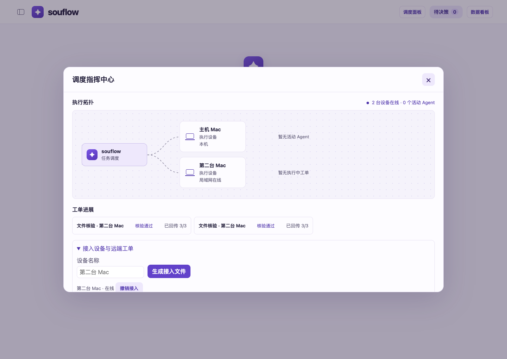
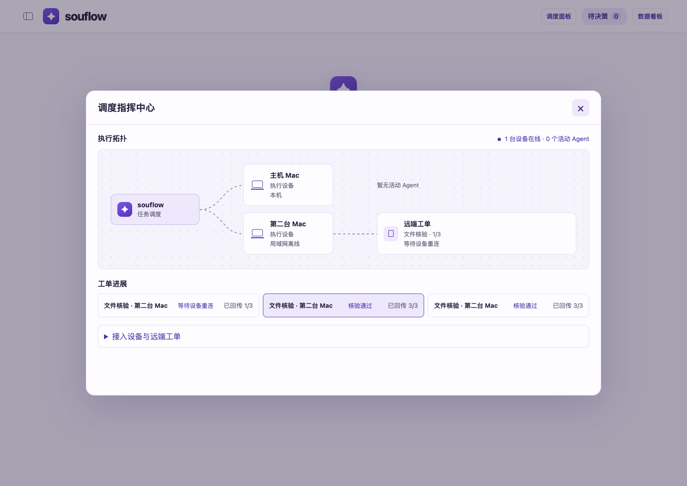
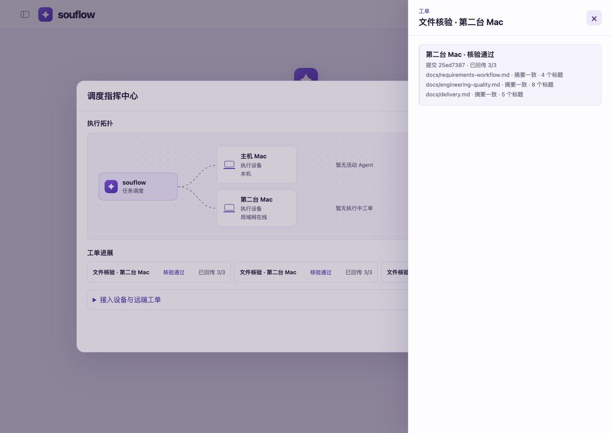

# B6 局域网设备接入与恢复实测

2026-11-22，两台实体 Mac 使用同一个 Wi‑Fi 热点。主机运行持久化 Codex 工作台。第二台 Mac 通过工作台生成的设备文件启动 Node.js 核验程序。工单固定基线 `25ed7387`，逐份核验其中的三份仓库文档。

| 验收项 | 实际观察 |
| --- | --- |
| 接入新设备 | 主机生成「第二台 Mac」的专用接入文件。设备在热点上连到主机的 HTTPS 端口后，调度拓扑显示两台设备在线。 |
| 按设备派单 | 主机选「第二台 Mac」并派发文件核验。第二台领取工单，工作台收到首份回执并显示 `1/3`。 |
| 断线保留进度 | 首份回执写入后，验收代理只关闭该设备与工作台之间的连接。主机持续运行，拓扑标明离线，原工单保留 `1/3` 和等待重连状态。 |
| 重连补报结果 | 恢复原 HTTPS 路径后，原工单完成到 `3/3`。三份回执的摘要和字节数均一致。审计中该工单的领取、完成各出现一次，其间有进度和设备重连记录。 |

自动化测试覆盖设备撤销、凭据和实例绑定、重复回执、持久状态恢复，以及从固定 Git 提交读取普通 Markdown 的边界。回归测试还验证了离线工单在其他设备完成 25 张工单后依然可见，且重连完成后能出现在最新结果里。本轮两台设备的验收对象是只读文件核验。远端 Codex 改代码、跨设备转派及其双成员交接仍待实测。[运行与接入](../architecture.md#局域网接入设备)
