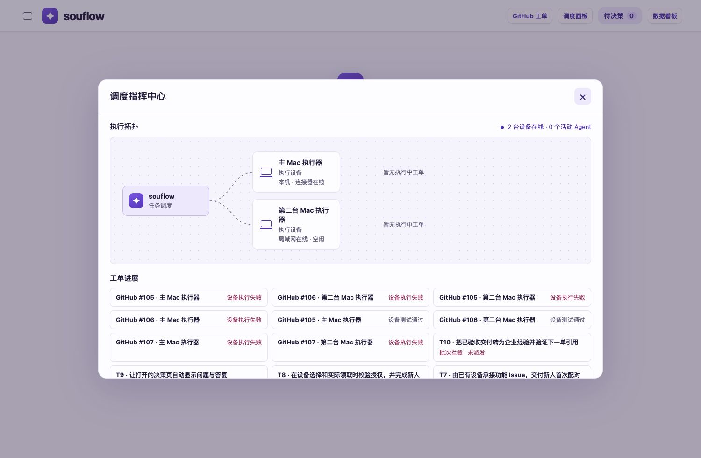
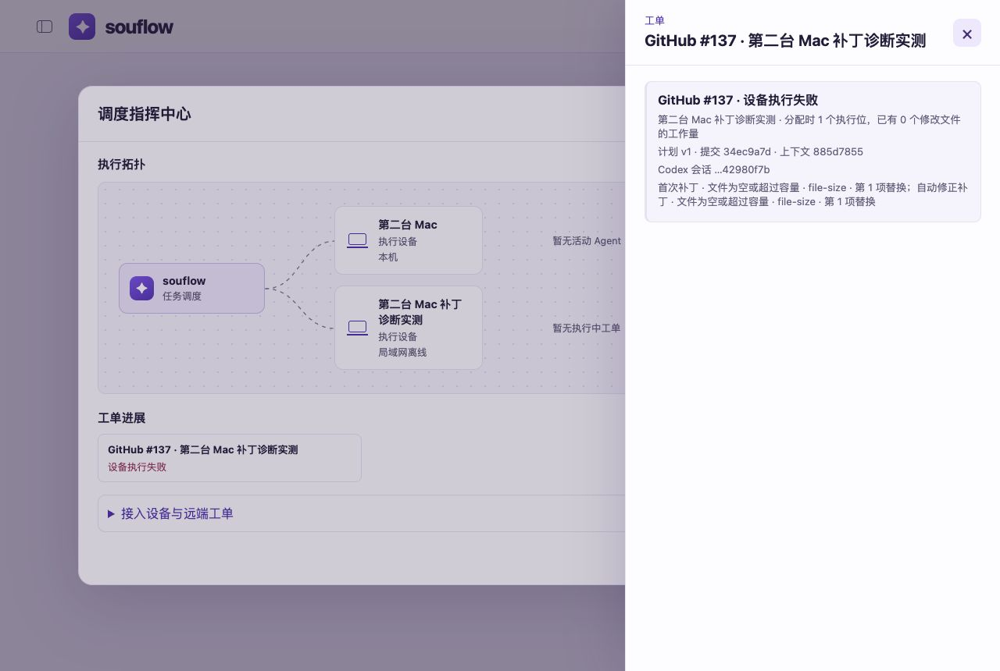
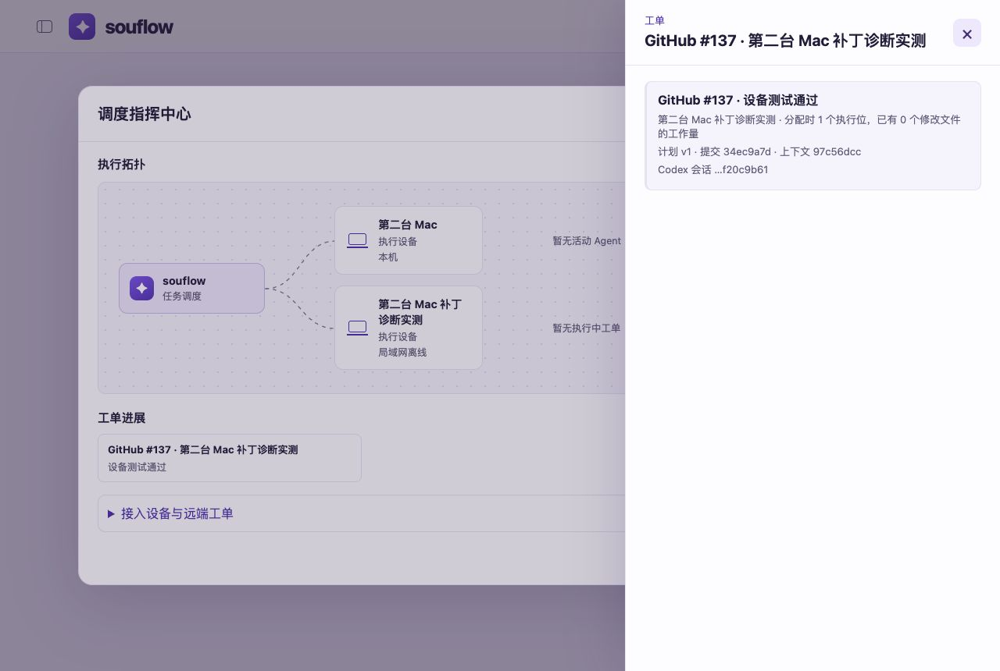

# 第二台 Mac 补丁诊断复验（#137）

维护者用本页核对 [#137](https://github.com/DikkooXie/souflow/issues/137) 的部署、第二台 Mac 原生 Codex 试验与回执，不把独立试验算入业务工单的新一轮执行。

2026-11-28，原工作台及两台 Mac 连接器已部署到合并提交 [`a12f22050847a8f7c7e5141f7eaec0e374cb76ba`](https://github.com/DikkooXie/souflow/commit/a12f22050847a8f7c7e5141f7eaec0e374cb76ba)（[实现 PR #141](https://github.com/DikkooXie/souflow/pull/141)）。第二台设备从 `03477a1` 升级，复用受信任的 SSH 连接操作；核对 HTTPS 接入、本机 Codex 登录及 Docker 29.8.0。未复制 Codex 凭据。

## 原工作台双机在线

原工作台的调度拓扑显示主 Mac 和第二台 Mac 同时在线、当前没有活动 Agent。图中的 #105、#106、#107 是此前记录；本轮没有向 #107 发起新的 offered、accepted 或 started，也没有创建其任务分支或 PR。

## 第二台 Mac 的独立正反例

两组试验分别使用第二台 Mac 上的独立 SQLite、独立设备和执行记录，通过 HTTPS 连接器使用该机已登录的真实 Codex。目标代码都固定在 `34ec9a7d`，实现版本为上述 `a12f220`。用例要求在同一文件前追加一行注释，补丁由 Codex 生成；试验执行结果留在独立工作区，没有提交到 GitHub。截图由第二台 Mac 的试验数据库重新启动工作台后，经 SSH 隧道读取。

| 验收条件 | 实际结果与证据 |
| --- | --- |
| 拒绝补丁时区分首次与自动修正，并保留编辑序号 | [失败回执](negative/result.json) 绑定执行 `802f356e-2a8e-4168-96a7-0ee63b0c2807`。首次和修正均为 `file-size`、第 1 项替换，工作台显示「文件为空或超过容量」。[审计](negative/audit.txt) 为 offered → accepted → started → failed，只有一次 started。 |
| 允许的补丁可以完成隔离检查并回报 | [成功回执](positive/result.json) 绑定执行 `ec8501d3-e3e9-46ee-a0c7-cccd0ed351d0`，状态 `tested`。[审计](positive/audit.txt) 为 offered → accepted → started → tested，只有一次 started。无网络容器的全量检查通过。 |
| 重复回执不增加开工次数，诊断恢复后仍可查 | 由同一实现版本的 [tests/patch-diagnostics.test.mts](../../../tests/patch-diagnostics.test.mts) 自动化测试覆盖：真实 SQLite 恢复后诊断可查、开工及失败回执重放只记录一次；首次业务回调失败后可补齐且成功通知仅一次。两组原生试验的审计只证明各自实际开工一次，不声称进行了网络回执重放。 |
| 日志不公开源码、提示或凭据 | 归档仅包含固定分类、序号、执行与设备标识及审计动作；三张原图已人工逐张检查，没有凭据、主机地址或本机目录。原始运行日志与数据库留在受控本机目录。格式、匹配、范围、容量和应用失败分类、自由文本拒绝及历史回执兼容性由上述自动化测试覆盖。 |

本页补齐第二台 Mac 的部署与实测，接续[主 Mac 的独立复验](../conversation-github-delivery.md#主-mac-设备补丁诊断复验137)。#137 的补丁诊断验收与 #107 的业务交付分别计数；B5 仍为「需求测试中 / 待验收」，完整首版交付继续沿用原验收链路。

## 归档检查

实现版本的[主干 Quality CI](https://github.com/DikkooXie/souflow/actions/runs/46141762448) 通过。本次文档工作区使用 Node 22.17.1 运行 `npm run check`：类型检查、静态检查通过，270 项测试中 267 项通过、3 项跳过、0 项失败。另核对三张归档图片与实测原图逐字节相同、两份审计各只有一次 `started`、回执状态及本地文档链接有效。
