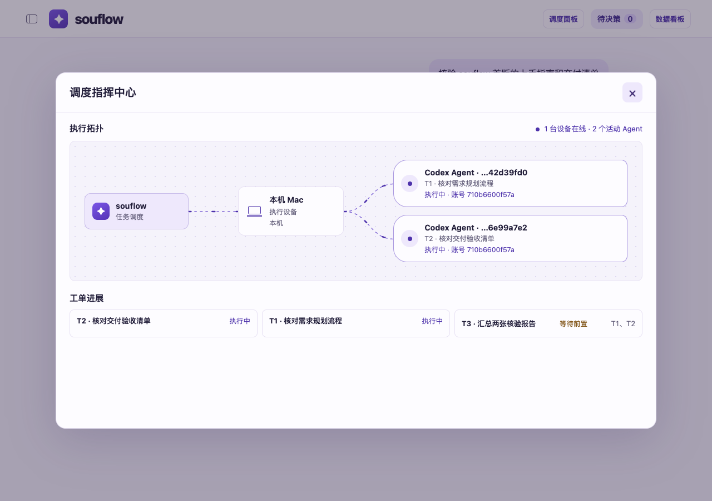
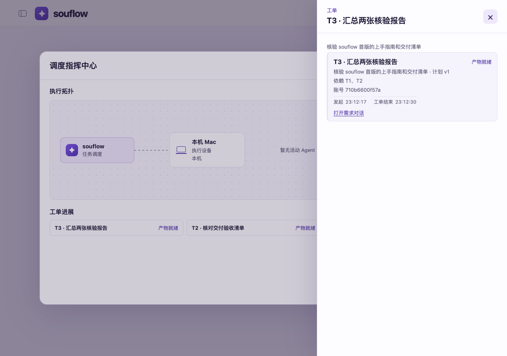

# 同一 Codex 账号多会话验收

2026-11-21 在 macOS、Node.js 22.17.1 和本机 Codex App Server 上，从浏览器工作台发起三张只读核验工单。核验资料取自仓库版本 `f18ccc7`，工作台实现对应提交 `76e2610`。规划与拆单输入固定，三张工单均由实际登录的 GPT-6.2 Sol 执行。

| 工单 | 实际观察 |
| --- | --- |
| T1 核对需求规划流程 | 在冻结的仓库版本读取 `docs/requirements-workflow.md`，产出报告。 |
| T2 核对交付验收清单 | 同时读取 `docs/engineering-quality.md`。两张工单的执行区间重叠 10.863 秒，面板同时观察到两个活动会话，共用一个账号标记。 |
| T3 汇总两张核验报告 | 两项前置完成后 1 毫秒开始，沿用同一账号，在第三个独立会话生成汇总报告。 |

重新启动工作台并打开同一份 SQLite 数据库，T3 详情仍显示原账号标记、依赖和产物状态。完成事件中三张工单的标记也一致。额外以 390 像素宽度检查了活动拓扑的布局。

协议测试覆盖同一用户、不同用户、账号回执晚于会话启动，以及缺少身份、接口返回错误或一直没有回执。该验收覆盖单机、同一登录、一个批次内的执行与依赖等待。跨账号额度分配、GitHub 认领和从自然语言自主拆出本轮工单另行验收。
