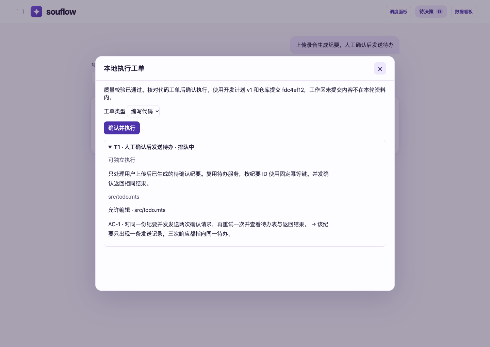
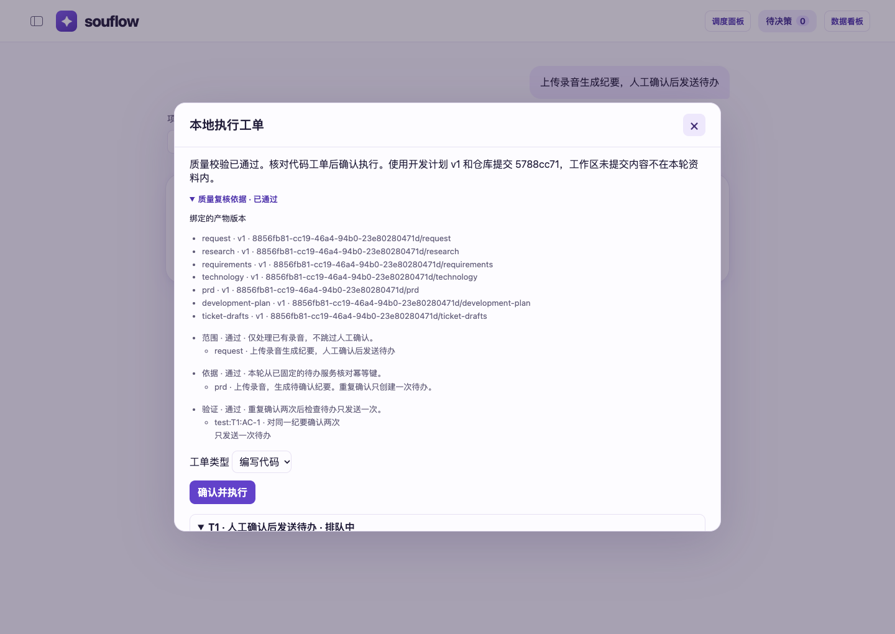

# 首版双机单账号代码协作实测

2026-11-22，两台实体 Mac 通过同一 Wi‑Fi 配合。主机通过已登记公钥的 SSH 连接启动第二台 Mac 的工单。分别读取两台本地 Codex App Server 的账号标识并比较本轮摘要，结果一致。两台机器各自复用本机 Codex 登录，GitHub 使用各自已有的连接。

| 工单 | 执行与验收 |
| --- | --- |
| 主机 [Issue #43](https://github.com/DikkooXie/souflow/issues/43) | 主机独立工作区交付派发前质量校验。本机 Sol 完成共享规则回归，Astra 只读评估核对一组通过及三组反例。原生检查 99 项通过。[PR #45](https://github.com/DikkooXie/souflow/pull/45) 合入 `b8bbc2bd06cf4d45540b63883c51bda4a1fabda6)。 |
| 第二台 Mac [Issue #44](https://github.com/DikkooXie/souflow/issues/44) | 从上游实际合并提交开始，在独立分支和工作区调用本机 Sol，实现「质量复核依据」折叠详情。通过 SSH 运行检查，浏览器通过 SSH 转发读取第二台 Mac 的实际工作台。 |

第二台 Mac 的默认检查 97 项通过、3 项原生用例按配置跳过。在隔离的本地模拟模型配置下，开启原生检查后 100 项通过。第二台的日常 Codex 配置中有两段回环测试失败，旧主干同环境也能复现；本地真实 Codex 开发使用原有登录。

第二台 Mac 的截图使用固定规划和复核样例。用于核对折叠详情、产物版本、验证引用和原执行确认。首版试用按 GitHub 合并提交交接，工作台网页配对、服务器发起代码和多机多账号验证属于服务器版。

